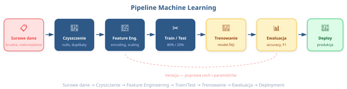

# 🤖 Wstęp do Machine Learning
## Przygotowanie danych i budowanie modeli ML — od brudnych danych do predykcji! 🧹➡️🔮

**Python w Zastosowaniach Big Data** | Wykład 4
Prowadzący: Pavlo Melnyk

---

## 📋 Plan wykładu

1. Co to jest Machine Learning? — definicja i typy
2. Pipeline danych ML — od surowych danych do modelu
3. Przygotowanie danych (Data Preparation)
4. Feature Engineering — sztuka tworzenia cech
5. Train/Test Split i walidacja
6. Budowanie modeli z scikit-learn
7. Ewaluacja modelu — skąd wiemy, że działa?
8. Praktyczny demo — end-to-end! 🚀

> 🎯 **Po tym wykładzie:** Będziesz potrafić wziąć brudne dane, wyczyścić je i zbudować swój pierwszy model ML!

---

## 💡 Dlaczego to ważne?

W 2025 roku Netflix zaoszczędził **1 miliard dolarów rocznie** dzięki systemowi rekomendacji opartemu na ML. A zaczęło się od... brudnych danych i prostego modelu! 🎬💰

| Firma | Zastosowanie ML | Efekt |
|-------|----------------|-------|
| Netflix | Rekomendacje filmów | -$1 mld kosztów churnu |
| Spotify | Discover Weekly | 40% więcej odtworzeń |
| Allegro | Ranking wyników | +15% konwersji |
| Gmail | Filtr spamu | 99.9% skuteczności |

> Każda z tych firm zaczęła od **czyszczenia danych**. Bez tego nawet najlepszy model jest bezużyteczny! 🧹

<!-- notes: Podkreśl, że ML to nie magia — to matematyka + dobre dane. 80% pracy data scientist to przygotowanie danych. -->

---

## 🧠 Co to jest Machine Learning?

**Machine Learning** (uczenie maszynowe) — dziedzina AI, w której komputer **uczy się wzorców z danych** zamiast być programowany regułami wprost.

**Tradycyjne programowanie:**
```
Dane + Reguły → Program → Wynik
```

**Machine Learning:**
```
Dane + Wyniki → Algorytm ML → Reguły (model)
```

> 💡 Pomyśl o tym tak: zamiast pisać `if/elif/else` na 10 000 przypadków, pokazujesz modelowi **przykłady** i mówisz: "naucz się tego sam!" 🎓

---

## 🤖 Typy Machine Learning

| Typ | Opis | Przykład |
|-----|------|---------|
| **Supervised Learning** 🏷️ | Mamy dane z etykietami (labels) | Spam/nie-spam, cena domu |
| **Unsupervised Learning** 🔍 | Brak etykiet — szukamy ukrytych wzorców | Segmentacja klientów, clustering |
| **Reinforcement Learning** 🎮 | Agent uczy się przez nagrody/kary | Gra w szachy, autonomiczne auto |

Dzisiaj skupiamy się na **Supervised Learning** — najbardziej popularnym i praktycznym typie!

- **Klasyfikacja** — przewidujemy kategorię (tak/nie, A/B/C)
- **Regresja** — przewidujemy liczbę (cena, temperatura, wiek)

---

## 🤔 Kiedy ML, a kiedy tradycyjne programowanie?

| Sytuacja | Podejście |
|----------|-----------|
| Reguły są jasne i niezmienne | ✅ Tradycyjne `if/else` |
| Wzorce w danych trudno opisać regułami | ✅ Machine Learning |
| Mało danych (< 100 przykładów) | ✅ Reguły ręczne |
| Dużo danych + powtarzalność | ✅ Machine Learning |
| Rozpoznawanie obrazów, tekst, dźwięk | ✅ ML / Deep Learning |
| Kalkulator, CRUD, proste walidacje | ✅ Tradycyjne programowanie |

> 🔑 **Zasada kciuka:** Jeśli potrafisz opisać problem w 10 regułach `if/else` — nie potrzebujesz ML. Jeśli potrzebujesz 10 000 — to czas na ML! 😄

---

## 🔄 Pipeline danych ML — Big Picture



> Dzisiaj przejdziemy przez **każdy** z tych kroków! Od brudnych danych do działającego modelu 💪

---

## 🧹 Przygotowanie danych — Dlaczego to 80% pracy?

Słyszeliście powiedzenie:

> **"Garbage in, Garbage out"** 🗑️➡️🗑️

Najlepszy model świata na brudnych danych da **śmieciowe wyniki**.

Typowe problemy w realnych danych:
- 🕳️ **Missing values** — brakujące wartości (NaN, None)
- 📋 **Duplikaty** — te same wiersze powtórzone
- 🦖 **Outliers** — wartości odstające (wiek: 999 lat?)
- 🔤 **Złe typy danych** — data jako string, cena jako tekst
- 📛 **Niespójne nazewnictwo** — "Warszawa", "warszawa", "WAWA"

---

## 🕳️ Brakujące wartości — Strategie

```python
import pandas as pd
import numpy as np

df = pd.DataFrame({
    "wiek": [25, np.nan, 30, 45, np.nan],
    "pensja": [4500, 5200, np.nan, 8000, 3500],
    "miasto": ["Warszawa", None, "Kraków", "Gdańsk", "Kraków"]
})

# Sprawdzamy brakujące wartości
print(df.isnull().sum())  # 👈 Ile NaN-ów w każdej kolumnie?

# Strategia 1: Usunięcie wierszy
df_dropped = df.dropna()  # ❌ Tracimy dane!

# Strategia 2: Wypełnienie medianą (dla liczb)
df["wiek"] = df["wiek"].fillna(df["wiek"].median())  # 👈 Bezpieczne
```

---

## 🕳️ Zaawansowane strategie — Imputation

```python
from sklearn.impute import SimpleImputer, KNNImputer

# Mean/Median/Mode imputer
imputer_mean = SimpleImputer(strategy="mean")       # 👈 Średnia
imputer_median = SimpleImputer(strategy="median")   # 👈 Mediana
imputer_mode = SimpleImputer(strategy="most_frequent")  # 👈 Moda

# KNN Imputer — wypełnia na podstawie "sąsiadów"
knn_imputer = KNNImputer(n_neighbors=3)  # 👈 Sprytniejsze!

# Użycie
import numpy as np
data = np.array([[25, 4500], [np.nan, 5200], [30, np.nan]])
data_filled = knn_imputer.fit_transform(data)
print(data_filled)  # Brakujące wartości uzupełnione!
```

> 💡 **KNNImputer** patrzy na podobne wiersze i "zgaduje" brakującą wartość. Jak pytanie kolegi, co było na wykładzie, gdy cię nie było! 😄

---

## 📋 Duplikaty i Outliers

```python
import pandas as pd

# === Duplikaty ===
df = pd.DataFrame({
    "imie": ["Anna", "Jan", "Anna", "Ewa"],
    "wiek": [25, 30, 25, 28]
})
print(f"Duplikaty: {df.duplicated().sum()}")  # 👈 Zliczamy
df_clean = df.drop_duplicates()               # 👈 Usuwamy

# === Outliers — metoda IQR ===
Q1 = df_clean["wiek"].quantile(0.25)
Q3 = df_clean["wiek"].quantile(0.75)
IQR = Q3 - Q1
lower = Q1 - 1.5 * IQR
upper = Q3 + 1.5 * IQR

# Filtrujemy tylko "normalne" wartości
df_no_outliers = df_clean[
    df_clean["wiek"].between(lower, upper)   # 👈 IQR method
]
```

---

## 🤔 Think About It — Kiedy NIE usuwać outlierów?

**Pytanie:** Masz dataset z transakcjami bankowych. Widzisz transakcję na 50 000 zł, gdy średnia to 500 zł. Czy to outlier do usunięcia?

**Odpowiedź:** Nie zawsze! 🤷

- 💰 Jeśli analizujesz **wzorce wydawania** — może to anomalia do usunięcia
- 🚨 Jeśli budujesz **detekcję fraudów** — to właśnie taki przypadek jest **najcenniejszy!**

> 🔑 **Kontekst biznesowy** decyduje, czy outlier to szum czy sygnał!

---

## ⚙️ Feature Engineering — Co to?

**Feature Engineering** — proces tworzenia, przekształcania i wybierania cech (features), które pomogą modelowi lepiej się uczyć.

To jak dawanie modelowi **lepszych okularów** 🤓 — te same dane, ale widzi więcej!

**Przed Feature Engineering:**
```
data: [data_zamówienia, kwota, kod_pocztowy]
```

**Po Feature Engineering:**
```
data: [dzień_tygodnia, miesiąc, kwota, kwota_log,
       jest_weekend, województwo, kategoria_kwoty]
```

> 💡 Dobry feature engineering to często **różnica między modelem 70% a 95% accuracy!**

---

## 🔤 Encoding kategoryczny — LabelEncoder

Modele ML rozumieją tylko **liczby**. Musimy zamienić tekst na wartości numeryczne!

```python
from sklearn.preprocessing import LabelEncoder

# LabelEncoder — zamienia kategorię na liczby (0, 1, 2, ...)
le = LabelEncoder()
miasta = ["Warszawa", "Kraków", "Gdańsk", "Kraków", "Warszawa"]
zakodowane = le.fit_transform(miasta)
print(zakodowane)  # [2, 1, 0, 1, 2]  👈 Ale uwaga!

# ⚠️ Problem: model "myśli", że Warszawa(2) > Kraków(1) > Gdańsk(0)
# To NIE ma sensu dla miast! Używaj LabelEncoder tylko dla
# danych z naturalnym porządkiem (np. "niski" < "średni" < "wysoki")
```

> ⚠️ **LabelEncoder** — OK dla danych ordinalnych, **nie** dla nominalnych!

---

## 🔤 Encoding kategoryczny — OneHotEncoder

```python
from sklearn.preprocessing import OneHotEncoder
import numpy as np

encoder = OneHotEncoder(sparse_output=False)  # 👈 Python 3.10+
miasta = np.array(["Warszawa", "Kraków", "Gdańsk"]).reshape(-1, 1)
encoded = encoder.fit_transform(miasta)

print(encoder.categories_)  # ['Gdańsk', 'Kraków', 'Warszawa']
print(encoded)
# [[0. 0. 1.]    👈 Warszawa = [0, 0, 1]
#  [0. 1. 0.]    👈 Kraków  = [0, 1, 0]
#  [1. 0. 0.]]   👈 Gdańsk  = [1, 0, 0]
```

> ✅ **OneHotEncoder** tworzy osobną kolumnę (0/1) dla każdej kategorii. Żadnych fałszywych relacji porządkowych!

---

## 📏 Skalowanie features — Kiedy i dlaczego?

**Problem:** Cechy mają różne skale!

| Cecha | Zakres | Bez skalowania |
|-------|--------|---------------|
| Wiek | 18–80 | ✅ OK |
| Pensja | 3 000–50 000 | 😱 Dominuje! |
| Pokoje | 1–6 | 😶 Zignorowane |

Bez skalowania, model **faworyzuje** cechy z dużymi wartościami.

```python
from sklearn.preprocessing import StandardScaler, MinMaxScaler

# StandardScaler — mean=0, std=1 (najczęściej używany)
scaler = StandardScaler()

# MinMaxScaler — skaluje do zakresu [0, 1]
min_max = MinMaxScaler()

# RobustScaler — odporny na outliers (używa mediany i IQR)
from sklearn.preprocessing import RobustScaler
robust = RobustScaler()  # 👈 Gdy masz outliers!
```

---

## 📏 Skalowanie w praktyce

```python
from sklearn.preprocessing import StandardScaler
import pandas as pd

df = pd.DataFrame({
    "wiek": [25, 30, 45, 22, 50],
    "pensja": [4500, 5200, 12000, 3800, 15000],
})

scaler = StandardScaler()
df_scaled = pd.DataFrame(
    scaler.fit_transform(df),        # 👈 fit + transform
    columns=df.columns
)
print(df_scaled.round(2))
#    wiek  pensja
# 0 -0.63  -0.63
# 1 -0.16  -0.37
# 2  1.25   1.16
# 3 -0.91  -0.89
# 4  1.72   1.84
```

> 🔑 **Zawsze** skaluj po train/test split! Scaler fitujemy **tylko** na danych treningowych!

---

## 🛠️ Tworzenie nowych features

```python
import pandas as pd

df = pd.DataFrame({
    "data_zamówienia": pd.to_datetime([
        "2026-01-15", "2026-03-22", "2026-07-04"
    ]),
    "cena": [150.0, 89.99, 299.50],
    "ilość": [2, 5, 1],
})

# Nowe features z daty
df["miesiąc"] = df["data_zamówienia"].dt.month       # 👈 Sezonowość
df["dzień_tygodnia"] = df["data_zamówienia"].dt.dayofweek
df["jest_weekend"] = df["dzień_tygodnia"].isin([5, 6]).astype(int)

# Nowe features z kolumn
df["wartość_total"] = df["cena"] * df["ilość"]        # 👈 Interakcja
df["cena_log"] = np.log1p(df["cena"])                  # 👈 Log-transform

print(df[["miesiąc", "jest_weekend", "wartość_total"]].to_string())
```

---

## 🎯 Feature Selection — Wybieramy najlepsze cechy

Nie wszystkie cechy pomagają modelowi. Niektóre **pogarszają** wyniki!

```python
import pandas as pd

df = pd.DataFrame({
    "wiek": [25, 30, 45, 22],
    "pensja": [4500, 5200, 12000, 3800],
    "wzrost_cm": [175, 180, 165, 170],
    "kupił": [0, 0, 1, 0],
})

# Metoda 1: Korelacja — usuwamy silnie skorelowane cechy
corr_matrix = df.corr()
print(corr_matrix["kupił"].sort_values(ascending=False))
# 👈 Zostawiamy cechy o najwyższej korelacji z targetem

# Metoda 2: Feature importance z modelu
from sklearn.ensemble import RandomForestClassifier
model = RandomForestClassifier(random_state=42)
model.fit(df[["wiek", "pensja", "wzrost_cm"]], df["kupił"])
print(dict(zip(df.columns[:-1], model.feature_importances_)))
```

---

## ✂️ Train/Test Split — Dlaczego dzielimy dane?

Wyobraź sobie, że ucząsz się do egzaminu z **odpowiedziami** 📖📝

Na egzaminie dostaniesz **100%**, ale czy naprawdę się nauczyłeś? 🤔

To samo z modelem ML — musimy **testować na danych, których nigdy nie widział!**

```python
from sklearn.model_selection import train_test_split

X = df[["wiek", "pensja", "wzrost_cm"]]  # 👈 Cechy (features)
y = df["kupił"]                           # 👈 Target (etykieta)

X_train, X_test, y_train, y_test = train_test_split(
    X, y,
    test_size=0.2,       # 👈 20% danych na test
    random_state=42,     # 👈 Powtarzalność wyników
    stratify=y,          # 👈 Zachowaj proporcje klas!
)
```

---

## ✂️ Cross-Validation — Jeszcze lepszy split

```python
from sklearn.model_selection import cross_val_score
from sklearn.ensemble import RandomForestClassifier

model = RandomForestClassifier(random_state=42)

# K-Fold Cross-Validation (k=5)
scores = cross_val_score(
    model, X, y,
    cv=5,               # 👈 5 foldów
    scoring="accuracy"
)
print(f"Accuracy per fold: {scores.round(3)}")
print(f"Mean: {scores.mean():.3f} ± {scores.std():.3f}")
```

> 💡 **Cross-validation** dzieli dane na k części. Każda część jest raz testem, k-1 razy treningiem. Bardziej wiarygodna ocena niż pojedynczy split!


---

## 🤖 Budowanie modelu — scikit-learn API

Piękno scikit-learn? **Każdy model ma ten sam interfejs!** 🎨

```python
from sklearn.linear_model import LogisticRegression
from sklearn.tree import DecisionTreeClassifier
from sklearn.ensemble import RandomForestClassifier

# Krok 1: Tworzymy model
model = RandomForestClassifier(random_state=42)

# Krok 2: Trenujemy na danych treningowych
model.fit(X_train, y_train)         # 👈 Nauka!

# Krok 3: Predykcja na danych testowych
y_pred = model.predict(X_test)       # 👈 Przewidywanie

# Krok 4: Ewaluacja
score = model.score(X_test, y_test)  # 👈 Accuracy
print(f"Accuracy: {score:.2%}")
```

> 🔑 `.fit()` → `.predict()` → `.score()` — zapamiętajcie te 3 metody!

---

## 🏷️ Klasyfikacja — Popularne modele

| Model | Kiedy używać | Zalety | Wady |
|-------|-------------|--------|------|
| **LogisticRegression** | Prosty problem, mało danych | Szybki, interpretowalny | Liniowy |
| **DecisionTree** | Chcesz zrozumieć decyzje | Wizualizacja, brak skalowania | Overfitting |
| **RandomForest** | Ogólne zastosowanie | Dokładny, odporny | Wolniejszy |
| **GradientBoosting** | Maksymalna dokładność | State-of-the-art | Trudny tuning |

```python
from sklearn.linear_model import LogisticRegression
from sklearn.tree import DecisionTreeClassifier
from sklearn.ensemble import RandomForestClassifier, GradientBoostingClassifier

models = {
    "LogReg": LogisticRegression(max_iter=1000),
    "DecTree": DecisionTreeClassifier(max_depth=5),
    "RF": RandomForestClassifier(n_estimators=100),
    "GBM": GradientBoostingClassifier(n_estimators=100),
}
```

---

## 📈 Regresja — Przewidywanie wartości ciągłych

```python
from sklearn.linear_model import LinearRegression
from sklearn.ensemble import RandomForestRegressor
from sklearn.metrics import mean_absolute_error, r2_score

# Przykład: przewidywanie ceny mieszkania
model = RandomForestRegressor(n_estimators=100, random_state=42)
model.fit(X_train, y_train)

y_pred = model.predict(X_test)

# Metryki regresji
mae = mean_absolute_error(y_test, y_pred)
r2 = r2_score(y_test, y_pred)

print(f"MAE: {mae:,.2f} zł")   # 👈 Średni błąd bezwzględny
print(f"R²: {r2:.3f}")          # 👈 Jak dobrze model wyjaśnia wariancję
# R² = 1.0 → idealny, R² = 0.0 → jak losowe zgadywanie
```

---

## 🔧 Pipeline w scikit-learn — Łączymy wszystko!

```python
from sklearn.pipeline import Pipeline
from sklearn.compose import ColumnTransformer
from sklearn.preprocessing import StandardScaler, OneHotEncoder
from sklearn.ensemble import RandomForestClassifier

# Definiujemy transformacje dla różnych typów kolumn
numeric_features = ["wiek", "pensja"]
categorical_features = ["miasto"]

preprocessor = ColumnTransformer(
    transformers=[
        ("num", StandardScaler(), numeric_features),       # 👈 Skaluj
        ("cat", OneHotEncoder(), categorical_features),    # 👈 Koduj
    ]
)

# Łączymy preprocessing + model w JEDEN pipeline!
pipeline = Pipeline([
    ("preprocessor", preprocessor),
    ("classifier", RandomForestClassifier(random_state=42)),
])

pipeline.fit(X_train, y_train)   # 👈 Fit wszystko naraz!
score = pipeline.score(X_test, y_test)
```

---

## 🤔 Think About It — Dlaczego Pipeline?

**Pytanie:** Dlaczego nie zrobić preprocessing ręcznie, krok po kroku?

**Odpowiedź — Pipeline rozwiązuje 3 problemy:**

1. ⚠️ **Data leakage** — Scaler fitowany na całych danych (train+test) = wyciek informacji!
   Pipeline gwarantuje: `fit()` tylko na train, `transform()` na test
2. 🔄 **Powtarzalność** — Jeden obiekt do `fit` + `predict`, łatwo zapisać
3. 🚀 **Deployment** — Pipeline to jeden obiekt do wdrożenia w produkcji

```python
# ❌ Źle — data leakage!
scaler.fit(X)  # Cały dataset!
X_scaled = scaler.transform(X)
X_train, X_test = train_test_split(X_scaled, ...)

# ✅ Dobrze — Pipeline robi to automatycznie!
pipeline.fit(X_train, y_train)  # 👈 Fit TYLKO na train
pipeline.predict(X_test)         # 👈 Transform + predict
```

---

## 📊 Ewaluacja — Metryki klasyfikacji

```python
from sklearn.metrics import (
    accuracy_score, precision_score, recall_score,
    f1_score, confusion_matrix, classification_report
)

y_test = [1, 0, 1, 1, 0, 1, 0, 0, 1, 0]
y_pred = [1, 0, 1, 0, 0, 1, 1, 0, 1, 0]

print(classification_report(y_test, y_pred))
#               precision  recall  f1-score
#     0 (nie)     0.80     0.80     0.80
#     1 (tak)     0.75     0.75     0.75
```

| Metryka | Co mierzy | Kiedy ważna |
|---------|----------|------------|
| **Accuracy** | % poprawnych | Zbalansowane klasy |
| **Precision** | Z tych co model wskazał, ile dobrych | Koszt false positive wysoki |
| **Recall** | Z tych co faktycznie są, ile znaleziono | Koszt false negative wysoki |
| **F1** | Harmonia precision i recall | Niezbalansowane klasy |

---

## 📊 Confusion Matrix — Wizualnie!

```python
from sklearn.metrics import ConfusionMatrixDisplay
import matplotlib.pyplot as plt

ConfusionMatrixDisplay.from_predictions(
    y_test, y_pred,
    display_labels=["Nie kupił", "Kupił"],
    cmap="Blues"
)
plt.title("Confusion Matrix 🤖")
plt.tight_layout()
plt.show()
```

```
                Predicted
              Nie    Tak
Actual  Nie [ TN  |  FP ]   👈 FP = "fałszywy alarm"
        Tak [ FN  |  TP ]   👈 FN = "przegapiony przypadek"
```

> 🏥 W medycynie **Recall** jest kluczowy — lepiej fałszywy alarm niż przegapiona choroba!

---

## 🧮 Confusion Matrix — Anatomia (Deep Dive)

Każda predykcja modelu klasyfikacyjnego może być jednym z **4 typów**:

| Typ | Nazwa | Co to znaczy | Przykład (test COVID) |
|-----|-------|--------------|----------------------|
| **TP** | True Positive | Model powiedział TAK, i to **prawda** ✅ | Chory → wykryto chorobę ✅ |
| **TN** | True Negative | Model powiedział NIE, i to **prawda** ✅ | Zdrowy → test negatywny ✅ |
| **FP** | False Positive | Model powiedział TAK, ale to **błąd** ❌ | Zdrowy → fałszywie "chory" 😱 |
| **FN** | False Negative | Model powiedział NIE, ale to **błąd** ❌ | Chory → przegapiony 💀 |

```python
from sklearn.metrics import confusion_matrix

y_true = [1, 1, 0, 1, 0, 0, 1, 0, 1, 0]  # Rzeczywiste klasy
y_pred = [1, 0, 0, 1, 0, 1, 1, 0, 0, 0]  # Predykcje modelu

cm = confusion_matrix(y_true, y_pred)
print(cm)
# [[4  1]   ← TN=4, FP=1
#  [2  3]]  ← FN=2, TP=3
```

---

## 🎯 Accuracy — Najprostszy wskaźnik

**Accuracy** = Ile predykcji było poprawnych?

$$
\text{Accuracy} = \frac{TP + TN}{TP + TN + FP + FN}
$$

```python
from sklearn.metrics import accuracy_score

y_true = [1, 1, 0, 1, 0, 0, 1, 0, 1, 0]
y_pred = [1, 0, 0, 1, 0, 1, 1, 0, 0, 0]

accuracy = accuracy_score(y_true, y_pred)
print(f"Accuracy: {accuracy:.2%}")  # 70%
# (TP=3 + TN=4) / 10 = 7/10 = 0.70
```

**⚠️ Problem:** Accuracy zawodzi przy **niezbalansowanych danych**!

```python
# 95% próbek to klasa 0, tylko 5% to klasa 1
# "Głupi model" który zawsze przewiduje 0 → 95% accuracy! 🤡
```

---

## 🎯 Precision — Dobrze celuj!

**Precision** (precyzja, dokładność) = Z tych co model **wskazał jako pozytywne**, ile faktycznie było pozytywnych?

$$
\text{Precision} = \frac{TP}{TP + FP}
$$

**Intuicja:** Czy model **nie strzela na oślep**? Czy jego pozytywne predykcje są wiarygodne?

```python
from sklearn.metrics import precision_score

precision = precision_score(y_true, y_pred)
print(f"Precision: {precision:.2%}")  # 75%
# TP=3 / (TP=3 + FP=1) = 3/4 = 0.75
```

**Przykład — Spam filter:**
- High precision = Jeśli oznaczy email jako SPAM, to prawdopodobnie jest SPAM
- Low precision = Często oznacza ważne maile jako spam (FP) 😱

> 🎯 Precision odpowiada na pytanie: **"Czy można zaufać pozytywnym predykcjom modelu?"**

---

## 🔍 Recall (Sensitivity) — Nic nie ucieknie!

**Recall** (czułość, sensitivity, TPR) = Z tych co **faktycznie są pozytywne**, ile model znalazł?

$$
\text{Recall} = \frac{TP}{TP + FN}
$$

**Intuicja:** Czy model **łapie wszystkie pozytywne przypadki**? Czy coś mu umyka?

```python
from sklearn.metrics import recall_score

recall = recall_score(y_true, y_pred)
print(f"Recall: {recall:.2%}")  # 60%
# TP=3 / (TP=3 + FN=2) = 3/5 = 0.60
```

**Przykład — Wykrywanie raka:**
- High recall = Model znajdzie większość chorych (mało FN)
- Low recall = Model przegapi wielu chorych (dużo FN) 💀

> 🔍 Recall odpowiada na pytanie: **"Czy model znajduje wszystko co powinien?"**

**Inne nazwy:** Sensitivity, True Positive Rate (TPR), Hit Rate

---

## 🤔 Precision vs Recall — Trade-off

Nie można mieć jednocześnie **100% precision** i **100% recall**!

| Scenariusz | Precision | Recall | Przykład |
|-----------|-----------|--------|---------|
| Model bardzo ostrożny | ⬆️ Wysoki | ⬇️ Niski | "Zgłaszam tylko gdy jestem 99% pewien" |
| Model bardzo wrażliwy | ⬇️ Niski | ⬆️ Wysoki | "Zgłaszam każde podejrzenie" |

**Analogia — Detektor metalu na lotnisku:**

```python
# Ustawienie "paranoia mode" 🚨
# Precision: Niska (piszczy na wszystko — klucze, zegarek, guziki)
# Recall:    Wysoka (NA PEWNO złapie każdy pistolet)

# Ustawienie "leniwiec mode" 😴
# Precision: Wysoka (jak już piszczy, to faktycznie coś groźnego)
# Recall:    Niska (przepuści część broni 💀)
```

> ⚖️ Musisz **wybrać balans** w zależności od kosztu FP vs FN!

---

## 🎯 F1-Score — Harmonia Precision i Recall

**F1-Score** = Średnia harmoniczna precision i recall

$$
F1 = 2 \times \frac{\text{Precision} \times \text{Recall}}{\text{Precision} + \text{Recall}}
$$

Lub krócej:

$$
F1 = \frac{2 \times TP}{2 \times TP + FP + FN}
$$

```python
from sklearn.metrics import f1_score

f1 = f1_score(y_true, y_pred)
print(f"F1-Score: {f1:.2%}")  # 67%

# Lub policzymy ręcznie:
precision = 0.75
recall = 0.60
f1_manual = 2 * (precision * recall) / (precision + recall)
print(f"F1 (manual): {f1_manual:.2%}")  # 67%
```

**Dlaczego średnia harmoniczna, a nie arytmetyczna?**
- Moyenne harmoniczna "karze" za duże różnice
- Jeśli precision=0.9, recall=0.1 → F1=0.18 (nie 0.5!)

> 🔑 **F1** to dobry **single metric** gdy mamy niezbalansowane dane!

---

## 🩺 Specificity — Prawdziwie Negatywne

**Specificity** (specyficzność, TNR) = Z tych co **faktycznie są negatywne**, ile model poprawnie rozpoznał?

$$
\text{Specificity} = \frac{TN}{TN + FP}
$$

**Intuicja:** Czy model dobrze **rozpoznaje negatywne przypadki**? Czy "nie krzyczy wilk!" bez powodu?

```python
# Specificity liczymy ręcznie z confusion matrix
tn, fp, fn, tp = confusion_matrix(y_true, y_pred).ravel()
specificity = tn / (tn + fp)
print(f"Specificity: {specificity:.2%}")  # 80%
# TN=4 / (TN=4 + FP=1) = 4/5 = 0.80
```

**Przykład — Test ciążowy:**
- High specificity = Jeśli test mówi "NIE", to na pewno nie ma ciąży (mało fałszywych alarmów)
- Low specificity = Często pokazuje ciążę gdy jej nie ma (FP)

**Inne nazwy:** True Negative Rate (TNR), Selectivity

---

## 📊 Precision/Recall/Specificity — Porównanie

| Metryka | Formula | Używamy gdy | Przykład zastosowania |
|---------|---------|------------|----------------------|
| **Precision** | $\frac{TP}{TP + FP}$ | Koszt FP wysoki | Filtr spamu — nie chcemy blokować ważnych maili |
| **Recall** | $\frac{TP}{TP + FN}$ | Koszt FN wysoki | Wykrywanie raka — musimy znaleźć WSZYSTKICH chorych |
| **Specificity** | $\frac{TN}{TN + FP}$ | Ważne TN | Testy medyczne — potwierdzenie "zdrowy" musi być wiarygodne |
| **F1-Score** | $\frac{2 \times P \times R}{P + R}$ | Balans P & R | Niezbalansowane dane, chcemy jedno ogólne score |

```python
# Kompleksowy raport
from sklearn.metrics import classification_report

print(classification_report(y_true, y_pred, target_names=["Zdrowy", "Chory"]))
#              precision  recall  f1-score  support
#     Zdrowy      0.67    0.80      0.73        5
#      Chory      0.75    0.60      0.67        5
```

> 🧠 **Pro tip:** W medical ML prawie zawsze optymalizujemy **Recall** (lepiej false alarm niż miss)!

---

## 📈 ROC Curve — Krzywa ROC

**ROC** (Receiver Operating Characteristic) = Wizualizacja trade-offu między **TPR** (Recall) a **FPR**

$$
\text{TPR (True Positive Rate)} = \text{Recall} = \frac{TP}{TP + FN}
$$

$$
\text{FPR (False Positive Rate)} = \frac{FP}{FP + TN}
$$

**Krzywa ROC** pokazuje jak TPR i FPR zmieniają się przy różnych **thresholdach** klasyfikacji.

```python
from sklearn.metrics import roc_curve, roc_auc_score
import matplotlib.pyplot as plt

# Model zwraca prawdopodobieństwa (np. LogisticRegression)
y_proba = model.predict_proba(X_test)[:, 1]  # Prawdopodobieństwo klasy 1

fpr, tpr, thresholds = roc_curve(y_test, y_proba)
auc = roc_auc_score(y_test, y_proba)

plt.plot(fpr, tpr, label=f"Model (AUC = {auc:.2f})")
plt.plot([0, 1], [0, 1], 'k--', label="Random guess (AUC = 0.50)")
plt.xlabel("False Positive Rate (FPR)")
plt.ylabel("True Positive Rate (TPR / Recall)")
plt.title("ROC Curve 📈")
plt.legend()
plt.grid(True, alpha=0.3)
plt.show()
```

---

## 📈 ROC Curve — Interpretacja

![ROC Curve](data:image/svg+xml;base64,PHN2ZyB3aWR0aD0iNjAwIiBoZWlnaHQ9IjUwMCIgeG1sbnM9Imh0dHA6Ly93d3cudzMub3JnLzIwMDAvc3ZnIj4KICA8IS0tIEJhY2tncm91bmQgLS0+CiAgPHJlY3Qgd2lkdGg9IjYwMCIgaGVpZ2h0PSI1MDAiIGZpbGw9IiNmOGY5ZmEiLz4KICAKICA8IS0tIEdyaWQgLS0+CiAgPGcgc3Ryb2tlPSIjZGRkIiBzdHJva2Utd2lkdGg9IjEiPgogICAgPGxpbmUgeDE9IjEwMCIgeTE9IjUwIiB4Mj0iMTAwIiB5Mj0iNDAwIi8+CiAgICA8bGluZSB4MT0iMTAwIiB5MT0iNDAwIiB4Mj0iNTUwIiB5Mj0iNDAwIi8+CiAgICAKICAgIDwhLS0gR3JpZCBsaW5lcyAtLT4KICAgIDxsaW5lIHgxPSIxMDAiIHkxPSIzMDAiIHgyPSI1NTAiIHkyPSIzMDAiIHN0cm9rZT0iI2VlZSIvPgogICAgPGxpbmUgeDE9IjEwMCIgeTE9IjIwMCIgeDI9IjU1MCIgeTI9IjIwMCIgc3Ryb2tlPSIjZWVlIi8+CiAgICA8bGluZSB4MT0iMTAwIiB5MT0iMTAwIiB4Mj0iNTUwIiB5Mj0iMTAwIiBzdHJva2U9IiNlZWUiLz4KICAgIAogICAgPGxpbmUgeDE9IjIxMCIgeTE9IjUwIiB4Mj0iMjEwIiB5Mj0iNDAwIiBzdHJva2U9IiNlZWUiLz4KICAgIDxsaW5lIHgxPSIzMjAiIHkxPSI1MCIgeDI9IjMyMCIgeTI9IjQwMCIgc3Ryb2tlPSIjZWVlIi8+CiAgICA8bGluZSB4MT0iNDM1IiB5MT0iNTAiIHgyPSI0MzUiIHkyPSI0MDAiIHN0cm9rZT0iI2VlZSIvPgogIDwvZz4KICAKICA8IS0tIFJhbmRvbSBndWVzcyBsaW5lIC0tPgogIDxsaW5lIHgxPSIxMDAiIHkxPSI0MDAiIHgyPSI1NTAiIHkyPSI1MCIgc3Ryb2tlPSIjOTk5IiBzdHJva2Utd2lkdGg9IjIiIHN0cm9rZS1kYXNoYXJyYXk9IjUsNSIvPgogIDx0ZXh0IHg9IjQ1MCIgeT0iMTIwIiBmaWxsPSIjNjY2IiBmb250LXNpemU9IjE0IiBmb250LWZhbWlseT0iQXJpYWwiPgogICAgUmFuZG9tIChBVUMgPSAwLjUwKQogIDwvdGV4dD4KICAKICA8IS0tIFBlcmZlY3QgbW9kZWwgLS0+CiAgPHBhdGggZD0iTSAxMDAgNDAwIEwgMTAwIDUwIEwgNTUwIDUwIiBzdHJva2U9IiM0Y2FmNTAiIHN0cm9rZS13aWR0aD0iMiIgZmlsbD0ibm9uZSIgc3Ryb2tlLWRhc2hhcnJheT0iMywyIiBvcGFjaXR5PSIwLjUiLz4KICA8dGV4dCB4PSIxMTAiIHk9IjcwIiBmaWxsPSIjNGNhZjUwIiBmb250LXNpemU9IjE0IiBmb250LWZhbWlseT0iQXJpYWwiPgogICAgUGVyZmVjdCAoQVVDID0gMS4wMCkKICA8L3RleHQ+CiAgCiAgPCEtLSBHb29kIG1vZGVsIC0tPgogIDxwYXRoIGQ9Ik0gMTAwIDQwMCBRIDEyMCAzNTAgMTUwIDI4MCBRIDE4MCAyMDAgMjIwIDEzMCBRIDI3MCA4MCAzODAgNjUgUSA0NjAgNTUgNTUwIDUwIiBzdHJva2U9IiMyMTk2RjMiIHN0cm9rZS13aWR0aD0iMyIgZmlsbD0ibm9uZSIvPgogIDx0ZXh0IHg9IjM4MCIgeT0iNzAiIGZpbGw9IiMyMTk2RjMiIGZvbnQtc2l6ZT0iMTYiIGZvbnQtd2VpZ2h0PSJib2xkIiBmb250LWZhbWlseT0iQXJpYWwiPgogICAgR29vZCBNb2RlbCAoQVVDID0gMC44OSkKICA8L3RleHQ+CiAgCiAgPCEtLSBXZWFrIG1vZGVsIC0tPgogIDxwYXRoIGQ9Ik0gMTAwIDQwMCBRIDE1MCAzNjAgMjUwIDI2MCBRIDM1MCAxNjAgNDUwIDEwMCBRIDUwMCA3NSA1NTAgNTAiIHN0cm9rZT0iI0ZGNTcyMiIgc3Ryb2tlLXdpZHRoPSIyIiBmaWxsPSJub25lIi8+CiAgPHRleHQgeD0iMzIwIiB5PSIyMzAiIGZpbGw9IiNGRjU3MjIiIGZvbnQtc2l6ZT0iMTQiIGZvbnQtZmFtaWx5PSJBcmlhbCI+CiAgICBXZWFrIChBVUMgPSAwLjY4KQogIDwvdGV4dD4KICAKICA8IS0tIEF4ZXMgbGFiZWxzIC0tPgogIDx0ZXh0IHg9IjMwMCIgeT0iNDcwIiBmaWxsPSIjMzMzIiBmb250LXNpemU9IjE4IiBmb250LXdlaWdodD0iYm9sZCIgZm9udC1mYW1pbHk9IkFyaWFsIiB0ZXh0LWFuY2hvcj0ibWlkZGxlIj4KICAgIEZhbHNlIFBvc2l0aXZlIFJhdGUgKEZQUikKICA8L3RleHQ+CiAgPHRleHQgeD0iMzAiIHk9IjI1MCIgZmlsbD0iIzMzMyIgZm9udC1zaXplPSIxOCIgZm9udC13ZWlnaHQ9ImJvbGQiIGZvbnQtZmFtaWx5PSJBcmlhbCIgdHJhbnNmb3JtPSJyb3RhdGUoLTkwLCAzMCwgMjUwKSI+CiAgICBUcnVlIFBvc2l0aXZlIFJhdGUgKFRQUiAvIFJlY2FsbCkKICA8L3RleHQ+CiAgCiAgPCEtLSBBeGVzIHRpY2tzIC0tPgogIDx0ZXh0IHg9IjEwMCIgeT0iNDIwIiBmaWxsPSIjNjY2IiBmb250LXNpemU9IjEyIiBmb250LWZhbWlseT0iQXJpYWwiIHRleHQtYW5jaG9yPSJtaWRkbGUiPjAuMDwvdGV4dD4KICA8dGV4dCB4PSIyMTAiIHk9IjQyMCIgZmlsbD0iIzY2NiIgZm9udC1zaXplPSIxMiIgZm9udC1mYW1pbHk9IkFyaWFsIiB0ZXh0LWFuY2hvcj0ibWlkZGxlIj4wLjI1PC90ZXh0PgogIDx0ZXh0IHg9IjMyMCIgeT0iNDIwIiBmaWxsPSIjNjY2IiBmb250LXNpemU9IjEyIiBmb250LWZhbWlseT0iQXJpYWwiIHRleHQtYW5jaG9yPSJtaWRkbGUiPjAuNTA8L3RleHQ+CiAgPHRleHQgeD0iNDM1IiB5PSI0MjAiIGZpbGw9IiM2NjYiIGZvbnQtc2l6ZT0iMTIiIGZvbnQtZmFtaWx5PSJBcmlhbCIgdGV4dC1hbmNob3I9Im1pZGRsZSI+MC43NTwvdGV4dD4KICA8dGV4dCB4PSI1NTAiIHk9IjQyMCIgZmlsbD0iIzY2NiIgZm9udC1zaXplPSIxMiIgZm9udC1mYW1pbHk9IkFyaWFsIiB0ZXh0LWFuY2hvcj0ibWlkZGxlIj4xLjA8L3RleHQ+CiAgCiAgPHRleHQgeD0iODAiIHk9IjQwNSIgZmlsbD0iIzY2NiIgZm9udC1zaXplPSIxMiIgZm9udC1mYW1pbHk9IkFyaWFsIiB0ZXh0LWFuY2hvcj0iZW5kIj4wLjA8L3RleHQ+CiAgPHRleHQgeD0iODAiIHk9IjMwNSIgZmlsbD0iIzY2NiIgZm9udC1zaXplPSIxMiIgZm9udC1mYW1pbHk9IkFyaWFsIiB0ZXh0LWFuY2hvcj0iZW5kIj4wLjI1PC90ZXh0PgogIDx0ZXh0IHg9IjgwIiB5PSIyMDUiIGZpbGw9IiM2NjYiIGZvbnQtc2l6ZT0iMTIiIGZvbnQtZmFtaWx5PSJBcmlhbCIgdGV4dC1hbmNob3I9ImVuZCI+MC41MDwvdGV4dD4KICA8dGV4dCB4PSI4MCIgeT0iMTA1IiBmaWxsPSIjNjY2IiBmb250LXNpemU9IjEyIiBmb250LWZhbWlseT0iQXJpYWwiIHRleHQtYW5jaG9yPSJlbmQiPjAuNzU8L3RleHQ+CiAgPHRleHQgeD0iODAiIHk9IjU1IiBmaWxsPSIjNjY2IiBmb250LXNpemU9IjEyIiBmb250LWZhbWlseT0iQXJpYWwiIHRleHQtYW5jaG9yPSJlbmQiPjEuMDwvdGV4dD4KPC9zdmc+)

**Interpretacja krzywej:**

| AUC Score | Jakość modelu | Co to znaczy |
|-----------|--------------|--------------|
| **1.00** | 🏆 Perfekcyjny | Model idealnie separuje klasy |
| **0.90-0.99** | ⭐ Excellent | Bardzo dobry model produkcyjny |
| **0.80-0.89** | ✅ Good | Solidny model, gotowy do użycia |
| **0.70-0.79** | 🆗 Fair | OK, ale można poprawić |
| **0.50-0.69** | ⚠️ Poor | Ledwo lepszy niż zgadywanie |
| **0.50** | 💀 Random | Jak rzut monetą |
| **< 0.50** | 🤡 Worse than random | Model robi coś odwrotnie! |

> 🎯 **AUC** (Area Under Curve) to **jedno uniwersalne score** dla klasyfikacji binarnej!

**Kiedy ROC/AUC:**
- ✅ Gdy chcesz model niezależny od threshold (0.5 domyślnie)
- ✅ Gdy dane są mniej więcej zbalansowane
- ❌ Gdy dane bardzo niezbalansowane → użyj **Precision-Recall Curve**

---

## 🤔 Think About It — Który model wybrać?

Masz 3 modele na tym samym datasecie:

| Model | Accuracy | Precision | Recall | F1 | AUC |
|-------|----------|-----------|--------|-----|-----|
| **A** | 92% | 85% | 70% | 0.77 | 0.88 |
| **B** | 88% | 75% | 90% | 0.82 | 0.92 |
| **C** | 85% | 95% | 60% | 0.74 | 0.85 |

**Pytanie:** Który model wybrać dla:
1. **Spam filter** — nie możemy blokować ważnych emaili
2. **Cancer detection** — musimy znaleźć wszystkich chorych
3. **Fraud detection** — równy balans między catch frauds i nie denerwować klientów

<details>
<summary>🔍 Odpowiedź</summary>

1. **Spam → Model C** — Precision 95% (jeśli oznaczy spam, to faktycznie jest spam)
2. **Cancer → Model B** — Recall 90% (znajdzie 90% chorych, słaby recall = tragedia)
3. **Fraud → Model B** — Najwyższy F1 (0.82) i AUC (0.92) = najlepszy balans

</details>

> 🔑 **Nie ma "najlepszego" modelu** — zależy od **problemu biznesowego!**

---

## 📊 Precision-Recall Curve — Alternatywa dla ROC

```python
from sklearn.metrics import precision_recall_curve, average_precision_score
import matplotlib.pyplot as plt

y_proba = model.predict_proba(X_test)[:, 1]

precision, recall, thresholds = precision_recall_curve(y_test, y_proba)
ap = average_precision_score(y_test, y_proba)

plt.plot(recall, precision, label=f"AP = {ap:.2f}")
plt.xlabel("Recall")
plt.ylabel("Precision")
plt.title("Precision-Recall Curve")
plt.legend()
plt.grid(True, alpha=0.3)
plt.show()
```

**Kiedy używać PR Curve zamiast ROC:**
- ✅ **Niezbalansowane dane** (np. 1% fraudów, 99% normalnych transakcji)
- ✅ Gdy **pozytywna klasa jest ważniejsza** (np. wykrywanie chorób)
- ✅ Gdy FP i FN mają różne koszty

> 💡 W caso niezbalansowanych danych: **PR Curve > ROC Curve**!

---

## 📈 Metryki regresji

```python
from sklearn.metrics import (
    mean_absolute_error,
    mean_squared_error,
    r2_score
)
import numpy as np

y_test = [100, 200, 300, 400, 500]
y_pred = [110, 190, 310, 380, 520]

mae = mean_absolute_error(y_test, y_pred)     # 👈 Średni błąd
mse = mean_squared_error(y_test, y_pred)      # 👈 Kara za duże błędy
rmse = np.sqrt(mse)                            # 👈 W jednostkach targetu
r2 = r2_score(y_test, y_pred)                  # 👈 0-1, im wyżej tym lepiej

print(f"MAE:  {mae:.1f}")    # 14.0
print(f"RMSE: {rmse:.1f}")   # 15.8
print(f"R²:   {r2:.3f}")     # 0.992
```

> 💡 **MAE** to "on average, our predictions are off by X". RMSE karze bardziej za duże błędy.

---

## ⚠️ Overfitting vs Underfitting

ML to **balans** — jak Złotowłosa szukająca "w sam raz" 🐻🥣

| | Underfitting 😴 | Just Right ✅ | Overfitting 🤯 |
|-|-----------------|--------------|----------------|
| **Problem** | Model za prosty | Idealny balans | Model za skomplikowany |
| **Train score** | Niski | Wysoki | Bardzo wysoki |
| **Test score** | Niski | Wysoki | Niski! |
| **Analogia** | Student nie nauczył się | Student rozumie temat | Student wykuł na pamięć |

```python
# Jak wykryć?
train_score = model.score(X_train, y_train)
test_score = model.score(X_test, y_test)

print(f"Train: {train_score:.3f}")  # 0.99  ← 🤔 Za dobrze?
print(f"Test:  {test_score:.3f}")   # 0.65  ← 😱 Overfitting!
```

---

## ⚠️ Jak walczyć z Overfittingiem?

| Strategia | Opis |
|-----------|------|
| 📉 **Więcej danych** | Najlepsza obrona! |
| 🌳 **Prostszy model** | Mniej parametrów, `max_depth` w drzewach |
| ✂️ **Regularyzacja** | L1/L2 penalty w LogisticRegression |
| 🔀 **Cross-validation** | Lepiej oceniamy generalizację |
| 🎒 **Feature selection** | Mniej features = mniej szumów |
| 🛑 **Early stopping** | Zatrzymaj trening, gdy test score spada |

```python
from sklearn.linear_model import LogisticRegression

# Regularyzacja — C kontroluje "ściskanie" wag
model_strong_reg = LogisticRegression(C=0.01)  # 👈 Silna regulacja
model_weak_reg = LogisticRegression(C=100.0)   # 👈 Słaba regulacja

# Drzewo — ograniczamy głębokość
from sklearn.tree import DecisionTreeClassifier
model_tree = DecisionTreeClassifier(max_depth=5)  # 👈 Nie za głęboko!
```

---

## 🚀 Praktyczny Demo — End-to-End ML Pipeline!

Zbudujemy kompletny model na datasecie **Titanic** 🚢

Cel: Przewidzieć, **kto przeżył** katastrofę Titanica

```python
import pandas as pd
from sklearn.model_selection import train_test_split

# Krok 1: Wczytanie danych
url = "https://raw.githubusercontent.com/datasciencedojo/datasets/master/titanic.csv"
df = pd.read_csv(url)

print(f"Kształt: {df.shape}")          # (891, 12)
print(f"Brakujące wartości:\n{df.isnull().sum()}")
print(f"\nPierwsze wiersze:")
print(df[["Survived", "Pclass", "Sex", "Age", "Fare"]].head())
```

> 🎬 Prawdziwe dane, prawdziwe problemy — brakujący wiek, mieszane typy danych!

---

## 🚀 Demo — Czyszczenie i Feature Engineering

```python
# Krok 2: Przygotowanie danych
df_ml = df[["Survived", "Pclass", "Sex", "Age", "SibSp",
            "Parch", "Fare", "Embarked"]].copy()

# Brakujące wartości
df_ml["Age"] = df_ml["Age"].fillna(df_ml["Age"].median())   # 👈 Mediana
df_ml["Embarked"] = df_ml["Embarked"].fillna("S")     # 👈 Moda

# Feature Engineering
df_ml["FamilySize"] = df_ml["SibSp"] + df_ml["Parch"] + 1  # 👈 Nowa cecha
df_ml["IsAlone"] = (df_ml["FamilySize"] == 1).astype(int)
df_ml["Fare_log"] = np.log1p(df_ml["Fare"])                  # 👈 Log-transform

# Podział na features i target
X = df_ml.drop("Survived", axis=1)
y = df_ml["Survived"]
print(f"Features: {list(X.columns)}")
```

---

## 🚀 Demo — Pipeline + Trening

```python
from sklearn.pipeline import Pipeline
from sklearn.compose import ColumnTransformer
from sklearn.preprocessing import StandardScaler, OneHotEncoder
from sklearn.ensemble import RandomForestClassifier
from sklearn.model_selection import train_test_split

num_features = ["Pclass", "Age", "SibSp", "Parch", "Fare_log", "FamilySize", "IsAlone"]
cat_features = ["Sex", "Embarked"]

preprocessor = ColumnTransformer([
    ("num", StandardScaler(), num_features),
    ("cat", OneHotEncoder(drop="first"), cat_features)])

pipeline = Pipeline([
    ("prep", preprocessor),
    ("model", RandomForestClassifier(n_estimators=200, random_state=42))])

X_train, X_test, y_train, y_test = train_test_split(
    X, y, test_size=0.2, random_state=42, stratify=y)
pipeline.fit(X_train, y_train)
```

---

## 🚀 Demo — Ewaluacja wyników

```python
from sklearn.metrics import classification_report, accuracy_score

y_pred = pipeline.predict(X_test)

print(f"🎯 Accuracy: {accuracy_score(y_test, y_pred):.2%}")
print(f"\n{classification_report(y_test, y_pred,
      target_names=['Nie przeżył', 'Przeżył'])}")

# Feature importance (z RandomForest)
import numpy as np
feature_names = (num_features +
    list(pipeline.named_steps["prep"]
         .transformers_[1][1].get_feature_names_out(cat_features)))
importances = pipeline.named_steps["model"].feature_importances_

for name, imp in sorted(zip(feature_names, importances),
                         key=lambda x: -x[1])[:5]:
    print(f"  {name:>15}: {'█' * int(imp * 50)} {imp:.3f}")
```

> 🏆 ~80% accuracy na Titanicu — z zaledwie kilkoma feature'ami i podstawowym modelem!

---

## 🚀 Demo — Porównanie modeli

```python
from sklearn.linear_model import LogisticRegression
from sklearn.tree import DecisionTreeClassifier
from sklearn.ensemble import (RandomForestClassifier,
                               GradientBoostingClassifier)
from sklearn.model_selection import cross_val_score

models = {
    "LogReg": LogisticRegression(max_iter=1000),
    "DecTree": DecisionTreeClassifier(max_depth=5),
    "RandomForest": RandomForestClassifier(n_estimators=200),
    "GBM": GradientBoostingClassifier(n_estimators=200),
}

print("📊 Porównanie modeli (5-fold CV):\n")
for name, model in models.items():
    pipe = Pipeline([("prep", preprocessor), ("model", model)])
    scores = cross_val_score(pipe, X_train, y_train, cv=5)
    print(f"  {name:>15}: {scores.mean():.3f} ± {scores.std():.3f}")
```

---

## 📋 scikit-learn Cheat Sheet

| Zadanie | Klasy |
|---------|-------|
| **Podział danych** | `train_test_split`, `cross_val_score` |
| **Brakujące wartości** | `SimpleImputer`, `KNNImputer` |
| **Encoding** | `OneHotEncoder`, `LabelEncoder`, `OrdinalEncoder` |
| **Skalowanie** | `StandardScaler`, `MinMaxScaler`, `RobustScaler` |
| **Klasyfikacja** | `LogisticRegression`, `RandomForestClassifier`, `GradientBoostingClassifier` |
| **Regresja** | `LinearRegression`, `RandomForestRegressor`, `GradientBoostingRegressor` |
| **Pipeline** | `Pipeline`, `ColumnTransformer` |
| **Metryki** | `accuracy_score`, `f1_score`, `mean_squared_error`, `r2_score` |
| **Walidacja** | `cross_val_score`, `GridSearchCV` |

> 🔗 Pełna dokumentacja: **scikit-learn.org**

---

## ⚠️ Najczęstsze pułapki początkujących

| # | Pułapka 🕳️ | Jak unikać ✅ |
|---|-----------|--------------|
| 1 | Fitowanie scalera na **całym** datasecie | Fit **tylko** na train! |
| 2 | Ignorowanie **missing values** | Zawsze sprawdzaj `.isnull().sum()` |
| 3 | Ewaluacja na **train** zamiast **test** | **Zawsze** oddzielaj test set |
| 4 | Używanie accuracy na **niezbalansowanych** danych | Użyj F1, precision, recall |
| 5 | Za dużo features, za mało danych | Feature selection + regularyzacja |
| 6 | Brak `random_state` | Wyniki niepowtarzalne! |

> 🔑 80% błędów w ML to **data leakage** i **zła ewaluacja**. Pipeline ratuje życie!

---

## 📝 Kluczowe wnioski

1. ✅ **ML** to nauka z danych — model uczy się wzorców, nie reguł
2. ✅ **80% pracy** to przygotowanie danych (czyszczenie, feature engineering)
3. ✅ **Pipeline** scikit-learn łączy preprocessing + model w jeden obiekt
4. ✅ **Train/test split** zapobiega overfittingowi — testuj na niewidzianych danych!
5. ✅ **Metryki** dobieraj do problemu — accuracy nie zawsze wystarczy

> 🧠 Zapamiętajcie: **lepsze dane > lepszy model**. Zacznijcie od czyszczenia!

---

## 🔮 Co dalej?

**Następny wykład:** Feature Engineering zaawansowany + Hyperparameter Tuning + MLOps

**Ćwiczenia:**
- 🏋️ Notebook: end-to-end ML pipeline na Titanic dataset
- 🎯 Zadanie domowe: zbuduj model na innym datasecie

**Do poczytania:**
- 📖 *Hands-On Machine Learning with Scikit-Learn, Keras & TensorFlow* — Aurélien Géron
- 🔗 scikit-learn.org — User Guide
- 📝 Kaggle.com — Titanic Competition (idealny first project!)

---

## ❓ Pytania?

### Dzięki za uwagę! 🎉

**Podsumowanie w jednym zdaniu:**
> Weź brudne dane → wyczyść → stwórz dobre features → zbuduj Pipeline → ewaluuj → iterate!

<!-- notes: Zachęć studentów do rozpoczęcia Kaggle Titanic — to klasyczny projekt na start z ML! -->
