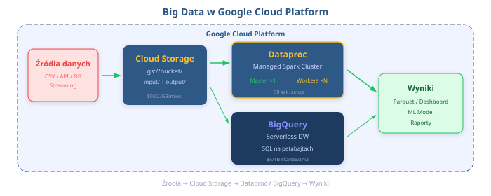

# ☁️ Cloud Computing i zarządzanie klastrami Spark w chmurze
## Wyobraź sobie 1000 serwerów na 2 godziny za $50 — to nie magia, to chmura! 🚀

**Python w Zastosowaniach Big Data** | Wykład 6
Prowadzący: Pavlo Melnyk

---

## 📋 Plan wykładu

1. Co to jest Cloud Computing? — definicja i modele usług
2. Dlaczego chmura dla Big Data?
3. Przegląd platform chmurowych — GCP vs AWS vs Azure
4. Google Cloud Platform — kluczowe usługi Big Data
5. Cloud Storage (GCS) — nasz data lake
6. BigQuery — serverless data warehouse
7. Dataproc — managed Spark w chmurze
8. Praktyczne demo — klaster Dataproc + job PySpark
9. Bezpieczeństwo i best practices
10. Google Cloud Skills Boost — nauka w praktyce

> 🎯 **Po tym wykładzie:** Będziesz potrafić uruchomić klaster Spark w chmurze GCP i submittować joby PySpark!

---

## 💡 Hook — Dlaczego tu jesteśmy?

Wyobraź sobie, że potrzebujesz **1000 serwerów na 2 godziny**. Kupujesz je? 😂

Nie — **włączasz je w chmurze za ~$50**, a potem wyłączasz. Koniec. Tyle. 🎤⬇️

```python
# Tradycyjne podejście 💸
koszt_serwera = 5000  # PLN za sztukę
serwery = 1000
print(f"Koszt: {koszt_serwera * serwery:,} PLN")  # 5,000,000 PLN 😱
print(f"Czas dostawy: 6-8 tygodni 📦")
print(f"Gdzie to postawisz? 🤷‍♂️")
```

```python
# Podejście chmurowe ☁️
koszt_godzina = 0.025  # USD za vCPU/h
print(f"Koszt: ~${koszt_godzina * 1000 * 2:.0f} za 2h")  # ~$50 🎉
print(f"Czas uruchomienia: ~90 sekund ⚡")
```

> Witaj w świecie **Cloud Computing**! ☁️

---

## 🌐 Co to jest Cloud Computing?

**Cloud Computing** (przetwarzanie w chmurze) — dostarczanie zasobów IT przez internet, na żądanie, z modelem **pay-as-you-go**.

Analogia czasu! 🏠

| Kryterium | Własne serwery | Chmura |
|-----------|---------------|--------|
| Analogia | **Kupno domu** 🏡 | **Wynajem mieszkania** 🏢 |
| Koszt początkowy | Ogromny 💸 | Zerowy ✅ |
| Elastyczność | Kupiłeś — masz | Zmień w 5 minut |
| Utrzymanie | Ty naprawiasz dach 🔧 | Zarządca budynku |
| Skalowanie | Dobuduj piętro? 😅 | Kliknij "więcej" |

> 🤔 **Think about it:** Czy Netflix miałby szansę obsłużyć 200 mln użytkowników, gdyby kupował własne serwery?

---

## 📦 Modele usług chmurowych — IaaS / PaaS / SaaS

Trzy warstwy, jak pizza! 🍕

| Model | Co dostajesz? | Twoja odpowiedzialność | Przykłady |
|-------|--------------|----------------------|-----------|
| **IaaS** | Serwery, sieć, storage | OS, runtime, aplikacja | GCE, EC2, Azure VMs |
| **PaaS** | + OS + runtime | Tylko aplikacja i dane | Dataproc, App Engine |
| **SaaS** | Wszystko gotowe | Tylko korzystasz! | Gmail, BigQuery, Slack |

**Analogia pizzowa** 🍕:
- **IaaS** = kupujesz składniki i piecziesz sam
- **PaaS** = dostajesz ciasto i składniki, kompletujesz sam
- **SaaS** = pizza z dostawą — jesz i tyle 😋

> Na tym kursie korzystamy głównie z **PaaS** (Dataproc) i **SaaS** (BigQuery) ☁️

---

## 🤔 Think about it — Który model usługi?

Przyporządkuj do modelu usługi:

1. 🖥️ Wynajmujesz wirtualną maszynę i instalujesz na niej Spark ręcznie
2. 📊 Otwierasz BigQuery w przeglądarce i piszesz zapytanie SQL
3. 🔥 Tworzysz klaster Dataproc i submitujesz job PySpark

<!-- Odpowiedzi: 1 = IaaS, 2 = SaaS, 3 = PaaS -->

---

## 🚀 Dlaczego chmura dla Big Data?

Big Data + Chmura = **najlepsi przyjaciele** 🤝

| Problem Big Data | Rozwiązanie chmurowe |
|-----------------|---------------------|
| Potrzebujesz 100 TB storage | Cloud Storage — zapłać za tyle ile masz |
| Obliczenia trwają za długo | Skaluj do 1000 maszyn na godzinę |
| Nowy projekt = nowy hardware? | Nowy klaster w 90 sekund ⚡ |
| Serwery stoją w nocy bez pracy | Wyłącz je — nie płacisz! 💤 |
| Budżet jest ograniczony | Pay-per-use — idealne dla startupów i uczelni |

> 💡 **Kluczowe:** W chmurze płacisz za **zużycie**, nie za **posiadanie**. To jak Uber vs własne auto 🚗

---

## 🌍 Przegląd platform chmurowych

Trzej wielcy (Big Three) ☁️:

| Cecha | GCP 🔵 | AWS 🟠 | Azure 🔷 |
|-------|---------|---------|-----------|
| Udział w rynku | ~12% | ~31% | ~25% |
| Spark managed | **Dataproc** | EMR | HDInsight |
| Data Warehouse | **BigQuery** | Redshift | Synapse |
| Object Storage | **GCS** | S3 | Blob Storage |
| Streaming | **Pub/Sub** | Kinesis | Event Hubs |
| ML Platform | Vertex AI | SageMaker | Azure ML |
| Darmowy tier | $300 / 90 dni | 12 mcy free tier | $200 / 30 dni |

> 🎯 **Na tym kursie** używamy **GCP** — najlepsze narzędzia do Big Data, prosty interfejs, darmowe kredyty dla studentów! 🎓

---

## 🔵 Google Cloud Platform — Ekosystem Big Data

Mapa naszych narzędzi — od danych surowych do insightów:



Dzisiaj skupimy się na **trzech filarach**:
1. ☁️ **Cloud Storage** — gdzie trzymamy dane
2. 🔥 **Dataproc** — gdzie przetwarzamy dane (Spark!)
3. 📊 **BigQuery** — gdzie analizujemy dane (SQL)

---

## ☁️ Cloud Storage (GCS) — nasz Data Lake

**Google Cloud Storage** — obiektowy storage (object storage), idealny jako data lake.

Podstawowe koncepty:
- **Bucket** — kontener na dane (jak folder główny) z unikalną globalnie nazwą
- **Object** — plik w buckecie (CSV, Parquet, JSON, obrazki...)
- **URI** — adres pliku: `gs://moj-bucket/dane/sprzedaz.parquet`

| Klasa przechowywania | Dostęp | Koszt/GB/msc | Kiedy używać? |
|----------------------|--------|-------------|---------------|
| **Standard** | Często | ~$0.020 | Dane aktywne |
| **Nearline** | 1x/msc | ~$0.010 | Backup miesięczny |
| **Coldline** | 1x/kwartał | ~$0.004 | Archiwa kwartalne |
| **Archive** | 1x/rok | ~$0.001 | Dane prawne, compliance |

> 💡 **Pro tip:** Parquet + Cloud Storage = idealny duet dla Big Data! 🤝

---

## ☁️ Cloud Storage — Praca z `gsutil`

```bash
# Tworzenie bucketu
gsutil mb -l europe-central2 gs://pjatk-bigdata-2026/

# Upload pliku
gsutil cp dane/sprzedaz.csv gs://pjatk-bigdata-2026/raw/

# Upload wielu plików równolegle (-m = multithreaded)
gsutil -m cp -r dane/ gs://pjatk-bigdata-2026/raw/  # 👈 dużo szybciej!

# Listowanie zawartości
gsutil ls gs://pjatk-bigdata-2026/raw/

# Pobranie pliku
gsutil cp gs://pjatk-bigdata-2026/raw/sprzedaz.csv ./local/
```

Odczyt z PySpark — **zero zmian w kodzie**:

```python
df = spark.read.parquet("gs://pjatk-bigdata-2026/raw/sprzedaz.parquet")
df.show(5)  # 👈 Spark czyta bezpośrednio z GCS!
```

---

## 📊 BigQuery — Serverless Data Warehouse

**BigQuery** — serverless data warehouse od Google, gdzie odpytujesz **petabajty danych** zwykłym SQL-em.

Jak to działa pod spodem? ⚙️

```
                BigQuery
         ┌─────────────────────┐
         │   Dremel Engine      │  ← silnik zapytań (masywny paralelizm)
         │   (query execution)  │
         └─────────┬───────────┘
                   │
         ┌─────────▼───────────┐
         │   Colossus           │  ← rozproszony storage (kolumnowy)
         │   (storage layer)    │
         └─────────────────────┘
```

- **Dremel** — rozbija zapytanie SQL na tysiące mikro-zadań → wykonuje równolegle
- **Colossus** — przechowuje dane w formacie kolumnowym (jak Parquet)
- **Bezserwerowy** — nie musisz zarządzać żadnym klastrem! 🎉

---

## 📊 BigQuery — SQL na petabajtach

```sql
-- Ile sprzedajemy w każdym regionie? 🛒
-- To zapytanie przetwarza 1 TB danych w ~5 sekund!
SELECT
    region,
    COUNT(*) AS liczba_transakcji,
    SUM(kwota) AS suma_sprzedazy,
    AVG(kwota) AS srednia_kwota
FROM `projekt.dataset.sprzedaz`
WHERE data >= '2026-01-01'
GROUP BY region
ORDER BY suma_sprzedazy DESC
LIMIT 10;
```

Model rozliczeniowy 💰:

| Model | Cena | Kiedy wybrać? |
|-------|------|---------------|
| **On-demand** | $7.50 / TB skanowanych | Nieprzewidywalne zapytania |
| **Flat-rate** | Od $2,000/msc | Stałe, intensywne użycie |
| **Darmowy tier** | 1 TB/msc + 10 GB storage | Idealne na start! 🎓 |

> ⚠️ **Uwaga:** BigQuery liczy za przeskanowane dane — `SELECT *` na 10 TB = $75! Zawsze wybieraj konkretne kolumny.

---

## 📊 BigQuery — Ładowanie danych

Wiele sposobów na załadowanie danych do BigQuery:

```bash
# Z pliku CSV
bq load --source_format=CSV \
    --autodetect \
    moj_dataset.sprzedaz \
    gs://pjatk-bigdata-2026/raw/sprzedaz.csv

# Z pliku Parquet (szybciej, mniejszy koszt!)
bq load --source_format=PARQUET \
    moj_dataset.sprzedaz \
    gs://pjatk-bigdata-2026/raw/sprzedaz.parquet
```

Obsługiwane formaty:
- 📄 **CSV** — popularny, ale wolniejszy
- 📋 **JSON** (newline-delimited) — elastyczny schemat
- 🚀 **Parquet** — kolumnowy, najszybszy!
- 📦 **Avro** — dobry do streamingu

> 💡 **Pro tip:** Parquet ładuje się do BigQuery ~5x szybciej niż CSV i zajmuje mniej miejsca!

---

## 📊 BigQuery + PySpark — Najlepsi przyjaciele

Integracja przez `spark-bigquery-connector`:

```python
# Czytanie danych z BigQuery do Spark DataFrame
df = (spark.read
      .format("bigquery")
      .option("table", "projekt.dataset.sprzedaz")
      .load())

df.printSchema()
df.show(5)  # 👈 Dane z BigQuery w Spark DataFrame!
```

```python
# Zapisywanie wyników z PySpark do BigQuery
(wyniki_df.write
    .format("bigquery")
    .option("table", "projekt.dataset.wyniki_analizy")
    .option("temporaryGcsBucket", "pjatk-bigdata-2026-temp")
    .mode("overwrite")
    .save())  # 👈 Spark → BigQuery, gotowe!
```

> 🔑 **Kluczowe:** Connector wymaga bucketa GCS jako temp storage dla danych pośrednich.

---

## 🔥 Dataproc — Managed Spark/Hadoop w GCP

**Dataproc** — w pełni zarządzany serwis do uruchamiania **Apache Spark**, Hadoop, Flink i Presto.

Dlaczego Dataproc, a nie Spark na własnych VM-kach?

| Kryterium | Spark na VM (DIY) | Dataproc (managed) |
|-----------|-------------------|---------------------|
| Czas setup | Godziny/dni 😩 | **~90 sekund** ⚡ |
| Konfiguracja | Ręczna instalacja | Gotowe do użycia |
| Skalowanie | Ręczne dodawanie nodów | **Autoscaling** 🔄 |
| Aktualizacje | Sam utrzymujesz | Google aktualizuje |
| Monitoring | Konfiguruj Grafanę... | Wbudowane dashboardy |
| Koszt | Płacisz nawet jak stoi | **Ephemeral clusters** — wyłącz i nie płać! |

> 🤔 **Think about it:** Po co utrzymywać klaster 24/7, jeśli joby trwają 2 godziny dziennie?

---

## 🔥 Dataproc — Architektura klastra

```
           Dataproc Cluster
     ┌──────────────────────────┐
     │      Master Node          │  ← zarządza klastrem
     │  (YARN ResourceManager,   │     (NameNode, Spark Driver)
     │   Spark History Server)   │
     └──────────┬───────────────┘
                │
     ┌──────────▼───────────────┐
     │    Worker Nodes (N)       │  ← wykonują obliczenia
     │  (YARN NodeManager,       │     (Spark Executors)
     │   HDFS DataNodes)         │
     └──────────┬───────────────┘
                │
     ┌──────────▼───────────────┐
     │  Preemptible Workers (M)  │  ← tańsze, ale mogą zniknąć!
     │  (tylko compute, bez HDFS)│     (60-80% taniej 💰)
     └──────────────────────────┘
```

- **Master** — 1 serwer zarządzający (lub 3 w trybie HA)
- **Workers** — serce klastra, tu dzieje się przetwarzanie
- **Preemptible Workers** — tańsze, ale Google może je odebrać w każdej chwili ⚠️

---

## 🔥 Dataproc — Tworzenie klastra (gcloud CLI)

```bash
# Tworzenie klastra Dataproc z autoscalingiem
gcloud dataproc clusters create pjatk-spark-cluster \
    --region=europe-central2 \
    --zone=europe-central2-a \
    --master-machine-type=n1-standard-4 \
    --master-boot-disk-size=100GB \
    --num-workers=2 \
    --worker-machine-type=n1-standard-4 \
    --worker-boot-disk-size=100GB \
    --num-secondary-workers=2 \
    --secondary-worker-type=preemptible \
    --image-version=2.1-debian11 \
    --enable-component-gateway \
    --optional-components=JUPYTER \
    --project=moj-projekt-pjatk
```

Kluczowe parametry:
- `--num-workers` — liczba stałych worker nodes
- `--num-secondary-workers` — preemptible (tańsze!) 💰
- `--enable-component-gateway` — dostęp do Spark UI przez przeglądarkę 🌐
- `--optional-components=JUPYTER` — Jupyter Notebook na klastrze! 📓

---

## 🔥 Dataproc — Autoscaling

Klaster, który sam rośnie i maleje? Tak, to możliwe! 🌱📈

```bash
# Tworzenie polityki autoscalingu
gcloud dataproc autoscaling-policies create pjatk-policy \
    --region=europe-central2 \
    --min-worker-fraction=0.5 \
    --max-worker-fraction=1.0 \
    --scale-up-factor=1.0 \
    --scale-down-factor=0.5 \
    --cooldown-period=120s \
    --worker-min-instances=2 \
    --worker-max-instances=10 \
    --secondary-worker-min-instances=0 \
    --secondary-worker-max-instances=20
```

```bash
# Podpięcie polityki do klastra
gcloud dataproc clusters create pjatk-autoscale \
    --region=europe-central2 \
    --autoscaling-policy=pjatk-policy \
    --num-workers=2
```

> 💡 Klaster skaluje się automatycznie pod obciążenie — oszczędzasz $$$ gdy jest mało pracy!

---

## 🔥 Dataproc — Submittowanie jobów PySpark

```bash
# Submit joba PySpark na klaster Dataproc
gcloud dataproc jobs submit pyspark \
    gs://pjatk-bigdata-2026/jobs/analiza_sprzedazy.py \
    --cluster=pjatk-spark-cluster \
    --region=europe-central2 \
    --jars=gs://spark-lib/bigquery/spark-bigquery-latest_2.12.jar \
    --py-files=gs://pjatk-bigdata-2026/libs/helpers.py \
    -- --input=gs://pjatk-bigdata-2026/raw/ \
       --output=gs://pjatk-bigdata-2026/results/
```

Elementy komendy:
- 📄 **Skrypt PySpark** — nasz kod w GCS
- 🔥 **--cluster** — nazwa klastra docelowego
- 📚 **--jars** — dodatkowe JAR-y (np. BigQuery connector)
- 📦 **--py-files** — dodatkowe moduły Python
- ⚙️ **--** — argumenty przekazywane do naszego skryptu

---

## 🔥 Dataproc — Przykładowy job PySpark

Plik `analiza_sprzedazy.py` uruchamiany na klastrze:

```python
from pyspark.sql import SparkSession
from pyspark.sql import functions as F
import argparse

parser = argparse.ArgumentParser()
parser.add_argument("--input", required=True)
parser.add_argument("--output", required=True)
args = parser.parse_args()

spark = SparkSession.builder.appName("AnalizaSprzedazy").getOrCreate()

df = spark.read.parquet(args.input)  # 👈 Czyta z GCS

wyniki = (df.groupBy("region", "kategoria")
            .agg(F.sum("kwota").alias("suma"),
                 F.count("*").alias("liczba"))
            .orderBy(F.desc("suma")))

wyniki.write.parquet(args.output, mode="overwrite")  # 👈 Zapisuje do GCS
spark.stop()
```

> 🔑 Ten sam kod PySpark, który pisaliśmy lokalnie — działa na klastrze **bez zmian**!

---

## 📈 Dataproc — Monitoring

Gdzie sprawdzać co się dzieje z naszymi jobami?

| Narzędzie | Co zobaczysz? | Jak dotrzeć? |
|-----------|---------------|-------------|
| **GCP Console** | Status jobów, logi | console.cloud.google.com |
| **Spark History Server** | Spark UI, DAG, stages | Component Gateway URL |
| **Cloud Monitoring** | CPU, RAM, dysk, sieć | Dashboardy i alerty |
| **Cloud Logging** | Logi aplikacji i drivera | Logs Explorer w GCP |

```bash
# Sprawdzanie statusu joba
gcloud dataproc jobs describe JOB_ID \
    --region=europe-central2

# Podgląd logów joba
gcloud dataproc jobs wait JOB_ID \
    --region=europe-central2
```

> 💡 **Component Gateway** daje Ci dostęp do Spark UI bezpośrednio z przeglądarki — super wygodne! 🌐

---

## 💰 Optymalizacja kosztów — Dataproc

Chmura jest elastyczna, ale łatwo przepalić budżet! Oto nasze triki:

### 1. Preemptible/Spot Workers 🎯
- **60-80% taniej** niż zwykłe VM
- Idealne do batch processing (mogą zostać odebrane!)

### 2. Ephemeral Clusters (tymczasowe) ⏱️
```bash
# Stwórz → Uruchom job → Usuń = płacisz tylko za czas pracy
gcloud dataproc clusters create temp-cluster ...
gcloud dataproc jobs submit pyspark ...
gcloud dataproc clusters delete temp-cluster  # 👈 natychmiast!
```

### 3. Scheduled Deletion 🗑️
```bash
# Klaster sam się usunie po 2 godzinach bezczynności
gcloud dataproc clusters create pjatk-cluster \
    --max-idle=2h  # 👈 auto-delete po 2h idle
```

### 4. Dobierz odpowiedni rozmiar maszyn
- Nie bierz `n1-highmem-96` jeśli wystarczy `n1-standard-4` 😄

---

## 🤔 Think about it — Koszty

Masz job PySpark, który przetwarza dane raz dziennie przez 1 godzinę.

**Opcja A:** Klaster stały (24/7, 3 worker nodes) → ~$2,160/msc
**Opcja B:** Ephemeral cluster (1h/dzień, 6 worker nodes) → ~$135/msc

Obie opcje dają ten sam wynik. Którą wybierasz? 🤔

> Odpowiedź: **Opcja B** — 16x tańsza! I szybsza, bo ma 2x więcej workerów! 🏎️💨

---

## 🛠️ Demo — Pełny workflow w GCP

Krok po kroku — od zera do wyników:

```bash
# 1. Utwórz bucket na dane
gsutil mb -l europe-central2 gs://pjatk-demo-2026/

# 2. Wgraj dane do GCS
gsutil cp sprzedaz.parquet gs://pjatk-demo-2026/data/

# 3. Wgraj skrypt PySpark
gsutil cp analiza.py gs://pjatk-demo-2026/jobs/

# 4. Utwórz klaster Dataproc
gcloud dataproc clusters create demo-cluster \
    --region=europe-central2 \
    --num-workers=2 \
    --max-idle=1h

# 5. Uruchom job
gcloud dataproc jobs submit pyspark \
    gs://pjatk-demo-2026/jobs/analiza.py \
    --cluster=demo-cluster \
    --region=europe-central2
```

---

## 🛠️ Demo — Wyniki i sprzątanie

```bash
# 6. Sprawdź wyniki
gsutil ls gs://pjatk-demo-2026/results/
gsutil cat gs://pjatk-demo-2026/results/part-00000.parquet | head

# 7. (Opcjonalnie) Załaduj wyniki do BigQuery
bq load --source_format=PARQUET \
    demo_dataset.wyniki_sprzedazy \
    gs://pjatk-demo-2026/results/*.parquet
```

```bash
# 8. Posprzątaj! 🧹 (żeby nie płacić!)
gcloud dataproc clusters delete demo-cluster \
    --region=europe-central2 --quiet

# Weryfikacja — czy klaster na pewno usunięty?
gcloud dataproc clusters list --region=europe-central2
```

> ⚠️ **ZAWSZE usuwaj klaster po pracy!** Zapomniany klaster to $$$$ 💸

---

## 🏗️ Bonus: Infrastruktura jako kod — Terraform

Zamiast klikać w konsoli, opisz klaster w kodzie:

```hcl
resource "google_dataproc_cluster" "spark_cluster" {
  name   = "pjatk-spark-cluster"
  region = "europe-central2"

  cluster_config {
    master_config {
      num_instances = 1
      machine_type  = "n1-standard-4"
    }
    worker_config {
      num_instances = 2
      machine_type  = "n1-standard-4"
    }
    preemptible_worker_config {
      num_instances = 2  # 👈 tańsze workery
    }
  }
}
```

> 💡 **Terraform** = powtarzalność, wersjonowanie, code review. DevOps ❤️ Infrastructure as Code!

---

## 🔄 Inne usługi GCP Big Data — szybki przegląd

### Dataflow (Apache Beam) 🌊
- **Batch + streaming** w jednym API
- Fully managed — zero zarządzania klastrem
- Idealny do ETL pipelines

### Pub/Sub 📬
- **Messaging** — jak Kafka, ale serverless
- Miliony wiadomości/sekundę
- Idealne do real-time data ingestion

```python
# Pub/Sub → Dataflow → BigQuery (streaming pipeline)
# 1. Dane przychodzą do Pub/Sub (np. z aplikacji mobilnej)
# 2. Dataflow przetwarza w czasie rzeczywistym
# 3. Wyniki lądują w BigQuery — gotowe do analizy!
```

> 🔮 To tematy na osobny wykład — dziś skupiamy się na **Dataproc** i **BigQuery**!

---

## 🛠️ Więcej narzędzi GCP dla Big Data

### Cloud Composer (Apache Airflow) 🎼
**Orchestration** — zarządzanie przepływem pracy (workflows)

```python
from airflow import DAG
from airflow.providers.google.cloud.operators.dataproc import DataprocSubmitJobOperator

# DAG definiuje sekwencję jobów
with DAG('daily_etl', schedule_interval='0 2 * * *') as dag:
    etl_job = DataprocSubmitJobOperator(
        task_id='process_data',
        job={'pySpark_job': {'main_python_file_uri': 'gs://...'}}
    )
```

**Kiedy używać?**
- ✅ Złożone pipelines z zależnościami (DAGs)
- ✅ Scheduled jobs (codziennie o 2:00, co godzinę, etc.)
- ✅ Retry logic i error handling

---

## 🛠️ Dataflow vs Dataproc — Kiedy co wybrać?

| Scenariusz | Dataproc (Spark) | Dataflow (Beam) |
|-----------|------------------|-----------------|
| Już masz kod PySpark | ✅ Użyj Dataproc | ⚠️ Rewrite do Beam |
| Batch processing | ✅ Świetny | ✅ Świetny |
| Real-time streaming | ✅ Structured Streaming | ✅ Natywny streaming |
| Zarządzanie klastrem | Musisz ustawić rozmiar | Autoscaling automatyczny |
| Ekosystem narzędzi | Spark ML, GraphX, SQL | Beam transforms |
| Koszt | Płacisz za cały klaster | Płacisz za worker-hours |

**Zasada kciuka:**
- **Masz już PySpark?** → Dataproc
- **Nowy projekt streaming?** → Dataflow
- **Interaktywna analiza?** → BigQuery

---

## 🛠️ Pub/Sub — Real-time Messaging

**Google Cloud Pub/Sub** — asynchroniczny system messagingowy (jak Kafka, ale serverless)

```python
from google.cloud import pubsub_v1

# Publisher (wysyła wiadomości)
publisher = pubsub_v1.PublisherClient()
topic_path = publisher.topic_path('projekt', 'transakcje')

message = '{"user_id": 123, "kwota": 49.99}'
future = publisher.publish(topic_path, message.encode('utf-8'))
print(f"Published message ID: {future.result()}")
```

```python
# Subscriber (odbiera wiadomości)
subscriber = pubsub_v1.SubscriberClient()
subscription_path = subscriber.subscription_path('projekt', 'sub-transakcje')

def callback(message):
    print(f"Received: {message.data.decode('utf-8')}")
    message.ack()  # Potwierdź odbiór

streaming_pull_future = subscriber.subscribe(subscription_path, callback)
streaming_pull_future.result()  # Blokuje i słucha
```

---

## 🛠️ Pub/Sub — Use Cases

**Kiedy używać Pub/Sub?**

| Use Case | Przykład |
|----------|---------|
| 🎮 **Game analytics** | Miliony eventów z gier mobilnych → real-time dashboards |
| 📱 **IoT data ingestion** | Sensory wysyłają dane co sekundę → Pub/Sub → Dataflow → BQ |
| 💳 **Payment processing** | Transakcje → Pub/Sub → fraud detection (real-time!) |
| 📧 **Notification system** | Event trigger → Pub/Sub → Cloud Function → Email/SMS |

**Architektura typowa:**
```
App/IoT → Pub/Sub → Dataflow → BigQuery → Looker (dashboard)
                  ↓
              Cloud Function (alerty)
```

> 📊 **Pub/Sub** to fundament real-time data pipelines w GCP! Przepustowość: 100M+ messages/sec!

---

## 🛠️ Cloud Composer — Orkiestracja workflows

**Cloud Composer** = Managed Apache Airflow

```python
from airflow import DAG
from airflow.providers.google.cloud.operators.dataproc import (
    DataprocCreateClusterOperator,
    DataprocSubmitJobOperator,
    DataprocDeleteClusterOperator
)
from airflow.providers.google.cloud.transfers.gcs_to_bigquery import GCSToBigQueryOperator
from datetime import datetime, timedelta

default_args = {
    'owner': 'pjatk',
    'start_date': datetime(2026, 4, 1),
    'retries': 2,
    'retry_delay': timedelta(minutes=5),
}

with DAG('daily_etl_pipeline', default_args=default_args, schedule_interval='@daily') as dag:
    
    # Step 1: Utwórz klaster
    create_cluster = DataprocCreateClusterOperator(
        task_id='create_cluster',
        cluster_name='temp-etl-cluster',
        num_workers=2,
        region='europe-central2'
    )
    
    # Step 2: Uruchom job PySpark
    run_spark_job = DataprocSubmitJobOperator(
        task_id='run_etl',
        job={'pyspark_job': {'main_python_file_uri': 'gs://pjatk/etl.py'}},
        cluster_name='temp-etl-cluster'
    )
    
    # Step 3: Załaduj wyniki do BigQuery
    load_to_bq = GCSToBigQueryOperator(
        task_id='load_results',
        bucket='pjatk-results',
        source_objects=['output/*.parquet'],
        destination_project_dataset_table='pjatk.dataset.results'
    )
    
    # Step 4: Usuń klaster
    delete_cluster = DataprocDeleteClusterOperator(
        task_id='delete_cluster',
        cluster_name='temp-etl-cluster'
    )
    
    # Kolejność wykonania
    create_cluster >> run_spark_job >> load_to_bq >> delete_cluster
```

---

## 🛠️ Cloud Composer — Visualization

Airflow UI pokazuje DAG graficznie:

```
┌─────────────────┐
│ create_cluster  │
└────────┬────────┘
         │
         ▼
┌─────────────────┐
│  run_spark_job  │
└────────┬────────┘
         │
         ▼
┌─────────────────┐
│  load_to_bq     │
└────────┬────────┘
         │
         ▼
┌─────────────────┐
│ delete_cluster  │
└─────────────────┘
```

**Korzyści:**
- ✅ Wizualizacja zależności
- ✅ Retry logic (jeśli job failuje)
- ✅ Scheduler (cron-like scheduling)
- ✅ Monitoring i alerty
- ✅ Historia wykonań (logs, duration, success rate)

> 🎼 **Composer** = Control Center dla Twoich data pipelines!

---

## 🔒 Security Best Practices — Deep Dive

### 1. IAM (Identity and Access Management) 🔐

**Zasada najmniejszych uprawnień** (Principle of Least Privilege):

```bash
# ❌ ZLE — Admin dla wszystkich
gcloud projects add-iam-policy-binding pjatk-projekt \
    --member="user:student@pjatk.pl" \
    --role="roles/owner"  # Zbyt szerokie!

# ✅ DOBRZE — Konkretne uprawnienia
gcloud projects add-iam-policy-binding pjatk-projekt \
    --member="user:student@pjatk.pl" \
    --role="roles/dataproc.worker"  # Tylko Dataproc worker
```

**Service Accounts** — dla aplikacji, nie userów:
```bash
# Utwórz Service Account dla jobów Spark
gcloud iam service-accounts create spark-jobs-sa \
    --display-name="Spark Jobs Service Account"

# Przypisz uprawnienia
gcloud projects add-iam-policy-binding PROJECT_ID \
    --member="serviceAccount:spark-jobs-sa@PROJECT_ID.iam.gserviceaccount.com" \
    --role="roles/dataproc.worker"
```

---

## 🔒 Security Best Practices — VPC & Firewall

### 2. VPC (Virtual Private Cloud) 🌐

**Stwórz prywatną sieć** dla klastrów Spark:

```bash
# Utwórz VPC
gcloud compute networks create pjatk-vpc \
    --subnet-mode=custom

# Dodaj subnet w Warszawie
gcloud compute networks subnets create pjatk-subnet \
    --network=pjatk-vpc \
    --region=europe-central2 \
    --range=10.0.0.0/24

# Klaster Dataproc w prywatnej sieci
gcloud dataproc clusters create secure-cluster \
    --network=pjatk-vpc \
    --subnet=pjatk-subnet \
    --no-address  # 👈 Brak publicznego IP!
```

**Firewall rules:**
```bash
# Zezwól tylko na SSH z określonych IP
gcloud compute firewall-rules create allow-ssh-from-office \
    --network=pjatk-vpc \
    --allow=tcp:22 \
    --source-ranges=85.128.100.50/32  # 👈 IP uczelni
```

---

## 🔒 Security Best Practices — Encryption & Secrets

### 3. Szyfrowanie 🔐

**Automatyczne w GCP:**
- ✅ **At rest** — dane na dysku zaszyfrowane (AES-256)
- ✅ **In transit** — TLS 1.3 między usługami

**Customer-managed encryption keys (CMEK):**
```bash
# Użyj własnego klucza z Cloud KMS
gsutil mb -l europe-central2 \
    -p PROJECT_ID \
    --encryption-key=projects/PROJECT/locations/europe/keyRings/RING/cryptoKeys/KEY \
    gs://secure-bucket
```

### 4. Secrets Management 🔑

**❌ NIE rób tego:**
```python
# Hasło w kodzie — ZŁE!
password = "super_secret_123"
```

**✅ Użyj Secret Manager:**
```python
from google.cloud import secretmanager

client = secretmanager.SecretManagerServiceClient()
name = "projects/PROJECT_ID/secrets/db-password/versions/latest"
response = client.access_secret_version(request={"name": name})
password = response.payload.data.decode('UTF-8')
```

---

## 💰 Cost Optimization — Advanced Strategies

### Strategia 1: Committed Use Discounts 💳

Zobowiązanie na 1 lub 3 lata = **do 57% taniej!**

```bash
# Kup commitment (1 rok, 10 vCPU, 40 GB RAM)
gcloud compute commitments create pjatk-1year \
    --plan=12-month \
    --resources=vcpu=10,memory=40GB \
    --region=europe-central2
```

**Kiedy warto?**
- ✅ Stabilne obciążenie (wiesz że będziesz używać cały czas)
- ✅ Produkcja z przewidywalnym traffic
- ❌ Rozwojowe środowiska (testujemy różne konfiguracje)

### Strategia 2: Rightsizing 📏

```bash
# Sprawdź wykorzystanie VM (czy nie przepłacasz?)
gcloud compute instances list --uri | while read uri; do
    gcloud compute instances describe $uri \
        --format="table(name, machineType, status)"
done

# Przykład: Zmniejsz maszynę jeśli CPU < 20%
gcloud compute instances set-machine-type INSTANCE \
    --machine-type=n1-standard-2  # 👈 z n1-standard-8
```

---

## 💰 Cost Optimization — Monitoring & Alerts

### Strategia 3: Budżety i alerty 🚨

```bash
# Utwórz budżet $100/miesiąc z alertami
gcloud billing budgets create \
    --billing-account=ACCOUNT_ID \
    --display-name="PJATK Course Budget" \
    --budget-amount=100USD \
    --threshold-rule=percent=50,basis=current-spend \
    --threshold-rule=percent=80,basis=current-spend \
    --threshold-rule=percent=100,basis=current-spend \
    --notification-channels=CHANNEL_ID
```

**Cloud Billing Reports:**
- 📊 Wizualizacja kosztów per usługa
- 📉 Trendy (porównanie miesiąc do miesiąca)
- 🔍 Drill-down (który projekt/bucket/klaster kosztuje najwięcej?)

**BigQuery dla billing data:**
```sql
-- Eksportuj billing do BigQuery i analizuj!
SELECT
    service.description AS usługa,
    SUM(cost) AS koszt_usd,
FROM `projekt.billing_export.gcp_billing_export_v1_XXX`
WHERE _PARTITIONTIME >= TIMESTAMP('2026-04-01')
GROUP BY 1
ORDER BY 2 DESC
LIMIT 10;
```

---

## 💰 Cost Optimization — Lifecycle Policies

### Strategia 4: Cloud Storage Lifecycle 🗑️

```json
{
  "lifecycle": {
    "rule": [
      {
        "action": {"type": "SetStorageClass", "storageClass": "NEARLINE"},
        "condition": {"age": 30}
      },
      {
        "action": {"type": "SetStorageClass", "storageClass": "COLDLINE"},
        "condition": {"age": 90}
      },
      {
        "action": {"type": "Delete"},
        "condition": {"age": 365}
      }
    ]
  }
}
```

**Zastosuj policy:**
```bash
gsutil lifecycle set lifecycle.json gs://pjatk-data-bucket/
```

**Oszczędności:**
- 📦 Standard → Nearline (30 dni) = **50% taniej**
- 📦 Nearline → Coldline (90 dni) = **60% taniej**
- 🗑️ Auto-delete po roku = **100% taniej** 😄

---

## 🎯 Best Practices — Cluster Management Checklist

Przed uruchomieniem klastra Dataproc, sprawdź:

### Rozmiar klastra 📏
- [ ] Czy potrzebujesz takiego dużego klastra?
- [ ] Czy możesz użyć mniejszych VM (n1-standard-2 zamiast n1-highmem-8)?

### Autoscaling i lifecycle 🔄
- [ ] Włączone autoscaling? (min/max workers)
- [ ] Ustawione `--max-idle` (np. 30m, 1h)?
- [ ] Scheduled deletion (jeśli to dev/test cluster)?

### Workers ⚙️
- [ ] Użyj preemptible workers dla batch jobs (60-80% taniej!)
- [ ] Dobierz stosunek: ~50% preemptible, 50% standard workers

### Networking 🌐
- [ ] Klaster w tym samym regionie co dane (latency!)
- [ ] Private IP (--no-address) jeśli nie potrzebujesz zewnętrznego dostępu

### Monitoring & Security 🔒
- [ ] Budżety i alerty włączone
- [ ] Service Account z minimalnymi uprawnieniami
- [ ] Logs eksportowane do Cloud Logging

> ✅ Ten checklist zaoszczędził setki dolarów na błędach studentów! 💸

---

## 🔒 Bezpieczeństwo w chmurze — Podstawy

Chmura jest bezpieczna... jeśli ją dobrze skonfigurujesz! 🔐

### IAM (Identity and Access Management) 👤
- **Principle of Least Privilege** — dawaj minimum uprawnień
- Konta serwisowe (Service Accounts) zamiast kluczy osobistych

### VPC (Virtual Private Cloud) 🌐
- Prywatna sieć dla Twoich zasobów
- Firewall rules — kto ma dostęp do czego

### Szyfrowanie 🔑
- **At rest** — dane zaszyfrowane na dysku (domyślnie w GCP!)
- **In transit** — TLS/SSL między usługami

### Budżety i alerty 💰🚨
```bash
# Ustaw alert budżetowy — żeby nie zbankrutować podczas snu 😅
gcloud billing budgets create \
    --billing-account=ACCOUNT_ID \
    --display-name="PJATK Big Data Budget" \
    --budget-amount=100USD \
    --threshold-rule=percent=80
```

---

## 🔒 Best Practices — Checklist

Zanim zaczniesz pracę z GCP, upewnij się:

- [ ] ✅ Włączone **budżety i alerty** (np. $50/msc)
- [ ] ✅ Klastry Dataproc mają **max-idle** lub **scheduled deletion**
- [ ] ✅ Dane w GCS w odpowiedniej **klasie przechowywania**
- [ ] ✅ Używasz **Service Account** zamiast klucza osobistego
- [ ] ✅ BigQuery: wybierasz **konkretne kolumny** (nie `SELECT *`)
- [ ] ✅ Preemptible workers dla jobów **odpornych na przerwy**
- [ ] ✅ Logi i monitoring **włączone**

> ⚠️ **Złota zasada:** Traktuj pieniądze w chmurze jak pieniądze w portfelu — kontroluj wydatki! 💳

---

## � Jak używać GCP bez karty kredytowej?

Masz 3 sposoby na ćwiczenie komend z zajęć — **wszystkie bez karty kredytowej!**

| Metoda | Co daje | Ograniczenia | Jak zacząć? |
|--------|---------|--------------|-------------|
| ☁️ **Cloud Skills Boost** | Tymczasowy projekt GCP z billingiem | Czas laba (1-8h) | cloudskillsboost.google |
| 🖥️ **Google Cloud Shell** | Terminal z `gcloud` CLI, 5GB storage | Bez własnego projektu z billingiem | shell.cloud.google.com |
| 📊 **BigQuery Sandbox** | 1 TB zapytań/msc, publiczne datasety | Brak trwałych tabel (60 dni) | console.cloud.google.com/bigquery |

### ☁️ Google Cloud Shell — darmowy terminal dla każdego!

```bash
# Otwórz: https://shell.cloud.google.com
# Wystarczy konto Gmail ✅

# Dostępne od razu:
gcloud --version          # gcloud CLI gotowy!
gsutil ls                 # Cloud Storage (tylko public buckets bez projektu)
bq ls                     # BigQuery CLI
python3 --version         # Python 3 pre-instalowany
pip install pyspark        # Możesz instalować pakiety!
```

### 🏆 Cloud Skills Boost — najlepsze dla Dataproc

```bash
# W trakcie laba → masz PEŁNY projekt GCP z billingiem na max ~8h
# Te komendy zadziałają!
gcloud dataproc clusters create moj-klaster \
    --region=us-central1 --single-node

gcloud dataproc jobs submit pyspark moj_job.py \
    --cluster=moj-klaster --region=us-central1

gcloud dataproc clusters delete moj-klaster --region=us-central1
```

> 🎯 **Rekomendacja:** `Dataproc: Qwik Start - Command Line` → ćwiczysz DOKŁADNIE komendy z wykładu, tymczasowy projekt Google, zero kosztów dla Ciebie!

---

## �🎓 Google Cloud Skills Boost (QwikLabs)

Najlepszy sposób na naukę GCP — **darmowe, praktyczne laby** w prawdziwym środowisku!

🔗 **https://www.cloudskillsboost.google/**

### Rekomendowane ścieżki:

| Ścieżka / Quest | Czas | Poziom |
|-----------------|------|--------|
| 🏗️ **Create and Manage Cloud Resources** | ~4h | Beginner |
| 📊 **Perform Foundational Data, ML, and AI Tasks** | ~6h | Intermediate |
| 🔥 **Data Engineering on Google Cloud** | ~16h | Advanced |
| 🚀 **Running Apache Spark jobs on Cloud Dataproc** | ~2h | Intermediate |

### 🟢 Darmowe laby na start (bez karty kredytowej!):

| Lab | Co ćwiczysz |
|-----|-------------|
| **Dataproc: Qwik Start - Command Line** | Komendy `gcloud dataproc` z wykładu |
| **Dataproc: Qwik Start - Console** | Klaster przez GUI |
| **BigQuery: Qwik Start - Console** | Zapytania SQL na publicznych danych |
| **Cloud Storage: Qwik Start - Console** | Bucket, upload plików |

### Dlaczego warto? 🤔
- 🖥️ Prawdziwe środowisko GCP (nie symulacja!) — te same komendy co na produkcji!
- 🎖️ Odznaki (badges) do CV i LinkedIn
- 💰 **Zero Twoich pieniędzy** — tymczasowy projekt z billingiem = bez karty kredytowej!
- 📝 Krok po kroku — idealne dla początkujących

> 🎯 **Zadanie domowe:** Ukończ lab **"Dataproc: Qwik Start - Command Line"** — to DOKŁADNIE komendy z wykładu w prawdziwej chmurze!

---

## 🗺️ Mapa ekosystemu — Jak to wszystko łączymy?

```
  📱 Źródła danych      ☁️ GCP Storage       ⚙️ Processing       📊 Analiza
  ─────────────        ──────────────      ──────────────     ─────────────
  Aplikacje web   →    Cloud Storage   →   Dataproc (Spark)→  BigQuery
  IoT sensory     →    (data lake)     →   Dataflow (Beam) →  (SQL analytics)
  Bazy danych     →                    →                   →  Looker (dashb.)
  Pliki CSV/JSON  →                    →                   →  Vertex AI (ML)
```

Na tym kursie opanowaliśmy:
- ✅ **PySpark** — przetwarzanie danych (Wykłady 1-5)
- ✅ **Cloud Storage** — przechowywanie danych (dziś)
- ✅ **Dataproc** — Spark w chmurze (dziś)
- ✅ **BigQuery** — analiza SQL (dziś)

> 🚀 Macie już kompletny toolbox do pracy z Big Data w chmurze!

---

## ⚠️ Najczęstsze pułapki studentów

| Pułapka | Konsekwencja | Jak uniknąć? |
|---------|-------------|--------------|
| Zapomnienie o usunięciu klastra | 💸 Rachunek rośnie 24/7 | `--max-idle=2h` |
| `SELECT *` w BigQuery na dużej tabeli | 💸 Skan wielu TB | Wybieraj kolumny! |
| Brak budżetu/alertów | 💸 Niespodzianka na koniec msc | Ustaw budżet od dnia 1 |
| Za duże maszyny | 💸 Płacisz za nieużywane zasoby | Zacznij od `n1-standard-2` |
| Dane w złym regionie | 🐌 Wolny transfer + opłaty | Wszystko w jednym regionie |
| Klucze API w kodzie | 🔓 Wyciek danych! | Używaj Service Accounts |

> 😅 **Fun fact:** Co roku studenci na całym świecie zostawiają włączone klastry... Nie bądź tą osobą!

---

## 📝 Podsumowanie — Key Takeaways

1. ☁️ **Cloud Computing** = zasoby IT na żądanie, model pay-as-you-go
2. 📦 **IaaS / PaaS / SaaS** — trzy warstwy abstrakcji (my używamy PaaS i SaaS)
3. 🔵 **GCP** oferuje kompletny ekosystem Big Data: GCS → Dataproc → BigQuery
4. 🔥 **Dataproc** = managed Spark — klaster w 90 sekund, autoscaling, preemptible workers
5. 📊 **BigQuery** = serverless SQL warehouse — petabajty bez zarządzania infrastrukturą
6. 💰 **Optymalizacja kosztów** — ephemeral clusters, `--max-idle`, preemptible VMs, budżety
7. 🎓 **Cloud Skills Boost** — darmowe, praktyczne laby do nauki GCP

> 🔑 **Zapamiętaj:** W chmurze **płacisz za to, co włączysz**. Wyłącz to, czego nie potrzebujesz! 💡

---

## 🔮 Co dalej?

### Następny wykład (Wykład 7):
📡 **Przetwarzanie strumieniowe — Kafka i Spark Structured Streaming**

### Do przeczytania:
- 📖 Google Cloud Dataproc Documentation
- 📖 BigQuery Best Practices (Google Cloud Blog)

### Zadania:
- 🏋️ **Ćwiczenia 6** — Praca z Dataproc i BigQuery w GCP
- 🎓 **QwikLabs** — Quest "Create and Manage Cloud Resources"

### Przydatne linki:
- 🔗 https://www.cloudskillsboost.google/
- 🔗 https://cloud.google.com/dataproc/docs
- 🔗 https://cloud.google.com/bigquery/docs

---

## ❓ Pytania?

### Dziękuję za uwagę!

> Do zobaczenia na Wykładzie 7!
