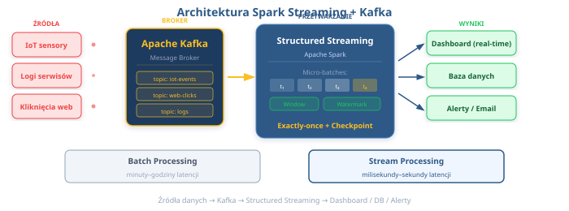

# ⚡ Spark Streaming i przetwarzanie strumieniowe danych
## Gdy dane nie czekają — Ty też nie powinieneś! 🌊

**Python w Zastosowaniach Big Data** | Wykład 7
Prowadzący: Pavlo Melnyk

---

## 📋 Plan wykładu

1. Co to jest przetwarzanie strumieniowe? — Batch vs Streaming
2. Modele gwarancji dostarczenia — semantyki at-most/at-least/exactly-once
3. Ekosystem streamingowy — Kafka, Flink, Storm, Spark
4. Spark Streaming — ewolucja od DStreams do Structured Streaming
5. Structured Streaming — koncepcje i architektura
6. Podstawowe operacje na strumieniach
7. Window operations — okna czasowe
8. Watermarks — obsługa spóźnionych danych
9. Integracja z Apache Kafka
10. Monitoring, debugging i checkpointing
11. Praktyczne demo — word count w czasie rzeczywistym
12. Przypadki użycia w biznesie

> 🎯 **Po tym wykładzie:** Będziesz potrafić budować pipeline'y przetwarzania strumieniowego w PySpark Structured Streaming!

---

## 💡 Hook — Dlaczego tu jesteśmy?

Kiedy płacisz kartą za granicą, bank ma **50 milisekund** na decyzję: zatwierdzić czy odrzucić transakcję. Nie ma czasu na batch processing — potrzebujemy streamingu! ⚡💳

```python
# Batch processing — za wolno! 🐌
# "Przeanalizujemy transakcje jutro rano..."
transakcje_z_dnia = spark.read.parquet("transakcje/2026-06-14/")
fraudy = transakcje_z_dnia.filter("kwota > 10000")
# Oszust już dawno wydał pieniądze 💸😱

# Stream processing — w czasie rzeczywistym! ⚡
# "Analizujemy KAŻDĄ transakcję w momencie gdy się pojawia"
stream = spark.readStream.format("kafka").load()
alerty = stream.filter("kwota > 10000")
# Karta zablokowana w 50ms! 🛡️✅
```

> Czas to pieniądz — dosłownie. Witajcie w świecie **stream processing**! 🌊

---

## 🔄 Batch vs Stream Processing

Dwa podejścia do przetwarzania danych:

| Kryterium | Batch Processing 📦 | Stream Processing 🌊 |
|-----------|---------------------|----------------------|
| Dane | Skończony zbiór | Nieskończony strumień |
| Przetwarzanie | "Zbierz, potem przetwórz" | "Przetwarzaj na bieżąco" |
| Opóźnienie | Minuty → godziny | Milisekundy → sekundy |
| Przykład | Raport dzienny sprzedaży | Alert o oszustwie |
| Złożoność | Prosta | Wyższa ⚠️ |
| Narzędzia | Spark (batch), Hive | Spark Streaming, Kafka, Flink |

> 💡 **Analogia:** Batch = pralka (zbierasz brudne rzeczy, potem pierzesz). Stream = zmywarka w restauracji (myjesz talerz od razu po użyciu) 🍽️

---

## 🌍 Kiedy potrzebujemy streamingu?

Streaming jest niezbędny, gdy **czas reakcji ma znaczenie**:

- 💳 **Wykrywanie oszustw** — decyzja w milisekundach
- 📈 **Giełda / trading** — ceny akcji zmieniają się co sekundę
- 🌡️ **IoT / czujniki** — temperatura w fabryce, GPS pojazdów
- 📱 **Social media** — trending topics na Twitterze/X w czasie rzeczywistym
- 🛒 **E-commerce** — rekomendacje "klienci również kupili..." na żywo
- 🚗 **Autonomiczne pojazdy** — przetwarzanie danych z sensorów LIDAR

> 🤔 **Think about it:** Netflix przetwarza **~500 miliardów eventów dziennie** w czasie rzeczywistym. Jak myślisz — batch czy streaming? 😏

---

## 🔐 Modele gwarancji dostarczenia

W przetwarzaniu strumieniowym kluczowe pytanie: **Ile razy przetworzymy każdy event?**

| Semantyka | Opis | Ryzyko | Przykład |
|-----------|------|--------|----------|
| **At-most-once** | Max 1 raz (może 0) | Utrata danych 😬 | Logi analityczne — ok, jeśli stracimy parę |
| **At-least-once** | Min 1 raz (może więcej) | Duplikaty 🔁 | Email z powiadomieniem — lepiej 2x niż 0x |
| **Exactly-once** | Dokładnie 1 raz ✅ | Złożoność ⚙️ | Przelew bankowy — MUSI być dokładnie raz! |

```python
# Exactly-once w Structured Streaming — Spark robi to za nas! 🎉
query = (stream
    .writeStream
    .outputMode("append")
    .option("checkpointLocation", "/checkpoint/fraud")  # 👈 Klucz do exactly-once!
    .start())
```

> 💡 **Checkpoint** = zapisany stan przetwarzania. Jeśli coś padnie, Spark wie gdzie wznowić.

---

## 🛠️ Ekosystem streamingowy — porównanie

Na rynku jest kilka narzędzi do stream processing:

| Narzędzie | Model | Opóźnienie | Ekosystem | Popularność |
|-----------|-------|-----------|-----------|-------------|
| **Apache Kafka** | Message broker + Kafka Streams | Bardzo niski | Ogromny | ⭐⭐⭐⭐⭐ |
| **Apache Flink** | Natywny streaming | Bardzo niski | Duży | ⭐⭐⭐⭐ |
| **Apache Storm** | Natywny streaming | Niski | Malejący | ⭐⭐ |
| **Spark Streaming** | Micro-batch + continuous | Niski–średni | Ogromny 🔥 | ⭐⭐⭐⭐⭐ |

> 🎯 **Nasz wybór:** Spark Structured Streaming — bo już znamy Sparka! Nie uczymy się nowego narzędzia od zera, a rozszerzamy to co umiemy 💪

---

## 📜 Spark Streaming — ewolucja

Spark miał dwa podejścia do streamingu. Historia wygląda tak:

### DStreams (Spark 1.x) — legacy, RDD-based 🦕
```python
# Stary sposób — DStreams (NIE UŻYWAMY!) ❌
from pyspark.streaming import StreamingContext
ssc = StreamingContext(sc, batchDuration=1)
lines = ssc.socketTextStream("localhost", 9999)
words = lines.flatMap(lambda line: line.split(" "))
# Problem: osobne API, brak optymalizatora, trudne joiny
```

### Structured Streaming (Spark 2.x+) — nowoczesne, DataFrame-based 🚀
```python
# Nowy sposób — Structured Streaming ✅
lines = spark.readStream.format("socket") \
    .option("host", "localhost") \
    .option("port", 9999).load()
words = lines.select(explode(split("value", " ")).alias("word"))
# Ten sam DataFrame API co w batchu! 🎉
```

> 💡 **Kluczowa różnica:** Structured Streaming = ten sam kod co batch, tylko `read` → `readStream`!

---

## 🤔 Think about it — DStreams vs Structured Streaming

Dlaczego świat Sparka przeszedł na Structured Streaming?

| Cecha | DStreams 🦕 | Structured Streaming 🚀 |
|-------|-----------|------------------------|
| API | RDD-based (niskopoziomowe) | DataFrame/Dataset (wysokopoziomowe) |
| Optymalizator | Brak Catalyst | Catalyst + Tungsten ⚡ |
| Event time | Brak natywnego wsparcia | Wbudowane watermarki |
| Exactly-once | Trudne do osiągnięcia | Wbudowane z checkpointami |
| Joiny stream-batch | Skomplikowane | Naturalny join! |
| Status | **Deprecated** od Spark 3.4 ⚠️ | Aktywny rozwój ✅ |

> 🎯 Od teraz mówimy **wyłącznie** o Structured Streaming. DStreams zostawiamy w muzeum 🏛️

---

## 🏗️ Structured Streaming — Unbounded Table

Kluczowa koncepcja: **strumień danych = nieskończona tabela**, do której ciągle dopisywane są nowe wiersze.

```
Czas:     t1        t2        t3        t4    ...
        ┌──────┐ ┌──────┐ ┌──────┐ ┌──────┐
Nowe    │ row1 │ │ row4 │ │ row7 │ │row10 │
dane:   │ row2 │ │ row5 │ │ row8 │ │row11 │
        │ row3 │ │ row6 │ │ row9 │ │      │
        └──────┘ └──────┘ └──────┘ └──────┘
                     ↓
           ┌─────────────────────┐
           │  Unbounded Table 📊 │
           │  row1, row2, row3,  │
           │  row4, row5, row6,  │
           │  row7, row8, row9,  │  ← Rośnie w nieskończoność!
           │  row10, row11, ...  │
           └─────────────────────┘
```

> 💡 Piszesz zapytanie na „tabeli" — Spark automatycznie aktualizuje wynik gdy przychodzą nowe dane!

---

## 📥 Input Sources — Skąd czytamy dane?

Structured Streaming wspiera kilka źródeł danych:

| Source | Opis | Produkcja? | Przypadek użycia |
|--------|------|-----------|-----------------|
| **Kafka** | Distributed message broker | ✅ Tak! | Główne źródło produkcyjne |
| **File** | Nowe pliki w katalogu | ✅ Tak | Pliki wrzucane do data lake |
| **Socket** | TCP socket (tekst) | ❌ Dev only | Testowanie / demo |
| **Rate** | Generuje dane testowe | ❌ Dev only | Benchmarking |

```python
# Kafka — produkcja 🏭
df = spark.readStream.format("kafka") \
    .option("kafka.bootstrap.servers", "broker:9092") \
    .option("subscribe", "transactions").load()

# Socket — development 🧪
df = spark.readStream.format("socket") \
    .option("host", "localhost").option("port", 9999).load()
```

---

## 📤 Output Sinks — Gdzie zapisujemy wyniki?

| Sink | Opis | Produkcja? | Przypadek użycia |
|------|------|-----------|-----------------|
| **Kafka** | Wysyłaj do topiku Kafka | ✅ Tak | Pipeline streaming-to-streaming |
| **File** | Parquet, JSON, CSV | ✅ Tak | Data lake, archiwizacja |
| **Console** | Wyświetl w terminalu | ❌ Dev only | Debugging |
| **Memory** | Tabela w pamięci | ❌ Dev only | Interaktywne zapytania SQL |
| **foreach/foreachBatch** | Własna logika zapisu | ✅ Tak | DB, API, custom sinks |

```python
# Zapis do plików Parquet 📁
query = (result.writeStream
    .format("parquet")
    .option("path", "/output/transactions/")
    .option("checkpointLocation", "/checkpoint/txn/")
    .start())
```

---

## 🔄 Output Modes — Jak aktualizujemy wyniki?

Trzy tryby zapisu wyników streamingu:

| Output Mode | Co zapisuje? | Kiedy używać? |
|-------------|-------------|---------------|
| **Append** | Tylko nowe wiersze | Proste filtry, mapy — bez agregacji |
| **Complete** | Cała tabela wyników | Agregacje (groupBy) — nadpisuje wszystko |
| **Update** | Zmienione wiersze | Agregacje — tylko zaktualizowane rekordy |

```python
# Append — nowe transakcje powyżej 10k 💰
query = alerts.writeStream.outputMode("append").start()

# Complete — aktualna suma per region 📊
query = region_totals.writeStream.outputMode("complete").start()

# Update — tylko zmienione regiony 🔄
query = region_totals.writeStream.outputMode("update").start()
```

> ⚠️ **Uwaga:** Nie każdy output mode działa z każdą operacją! Append + groupBy = błąd! 💥

---

## ⏱️ Triggers — Kiedy przetwarzamy dane?

Trigger określa **jak często** Spark przetwarza nowe dane:

| Trigger | Opis | Opóźnienie |
|---------|------|-----------|
| **Default (micro-batch)** | Natychmiast po poprzednim batchu | Najniższe |
| **processingTime** | Co X czasu (np. co 10 sekund) | Kontrolowane |
| **once** | Jeden raz i koniec | N/A — batch-like |
| **availableNow** | Przetwórz dostępne dane i zakończ | N/A — batch-like |

```python
# Domyślny — jak najszybciej ⚡
query = df.writeStream.start()

# Co 30 sekund ⏰
query = df.writeStream.trigger(processingTime="30 seconds").start()

# Jednorazowo — idealny do backfillu 📦
query = df.writeStream.trigger(once=True).start()

# Przetwórz co jest i zakończ (Spark 3.3+) ✅
query = df.writeStream.trigger(availableNow=True).start()
```

---

## 💻 Podstawowe operacje — readStream / writeStream

Structured Streaming = **ten sam DataFrame API**, ale z `readStream` i `writeStream`:

```python
from pyspark.sql import SparkSession
from pyspark.sql.functions import col, upper, current_timestamp

spark = SparkSession.builder.appName("BasicStream").getOrCreate()

# 1️⃣ Czytamy strumień z plików CSV
stream_df = (spark.readStream       # 👈 readStream zamiast read!
    .format("csv")
    .option("header", True)
    .schema("name STRING, city STRING, amount DOUBLE")
    .load("/input/transactions/"))

# 2️⃣ Transformacje — dokładnie jak na zwykłym DataFrame!
filtered = (stream_df
    .filter(col("amount") > 100)    # 👈 Zwykły filter
    .withColumn("city_upper", upper(col("city"))))

# 3️⃣ Zapisujemy wynik
query = (filtered.writeStream       # 👈 writeStream zamiast write!
    .format("console")
    .outputMode("append")
    .start())
```

---

## 🔍 Operacje strumieniowe — select, filter, groupBy

Znasz DataFrame API? To już umiesz Structured Streaming! 🎉

```python
from pyspark.sql.functions import col, sum as _sum, count, avg

# Filtrowanie — transakcje powyżej 1000 PLN
duze_transakcje = stream_df.filter(col("amount") > 1000)

# Selekcja i transformacja
przetworzone = stream_df.select(
    col("name"),
    col("city"),
    (col("amount") * 1.23).alias("amount_with_vat")  # 👈 VAT 23%!
)

# Agregacja — suma transakcji per miasto
per_miasto = (stream_df
    .groupBy("city")                        # 👈 groupBy jak w batchu
    .agg(
        _sum("amount").alias("total"),
        count("*").alias("count"),
        avg("amount").alias("avg_amount")
    ))
# ⚠️ Pamiętaj: groupBy wymaga outputMode("complete") lub ("update")!
```

---

## 🔗 Streaming + Batch Joins

Możesz łączyć strumień z tabelą statyczną — **stream-to-batch join**:

```python
# Tabela statyczna — informacje o klientach 👤
klienci = spark.read.parquet("/data/klienci.parquet")
# | klient_id | imie      | segment |
# |-----------|-----------|---------|
# | 101       | Anna      | VIP     |
# | 102       | Bartosz   | Regular |

# Strumień — transakcje w czasie rzeczywistym 💳
transakcje = spark.readStream.format("kafka").load()

# JOIN — wzbogacamy strumień o dane klienta! 🤝
wzbogacone = transakcje.join(
    klienci,
    transakcje.klient_id == klienci.klient_id,
    "left"  # 👈 left join — nie tracimy transakcji bez klienta
)

# Teraz mamy segment klienta w strumieniu!
vip_alerts = wzbogacone.filter(col("segment") == "VIP")
```

> 💡 **Stream-batch join** = najczęstszy pattern w produkcji. Wzbogacanie eventów o dane referencyjne.

---

## 🪟 Window Operations — Okna czasowe

Window operations pozwalają agregować dane **w oknach czasowych**. Trzy rodzaje:

```
Tumbling Window (10 min):
|────────|────────|────────|────────|
 00:00    00:10    00:20    00:30

Sliding Window (10 min, slide 5 min):
|────────|
     |────────|
          |────────|
               |────────|

Session Window (gap 5 min):
|──────|     |────────────|  |───|
 events       events         events
```

> 💡 **Tumbling** = okna nie zachodzą na siebie. **Sliding** = okna zachodzą na siebie. **Session** = okna dopasowują się do aktywności.

---

## 🪟 Tumbling Windows — Okna stałe

Tumbling window = okno o stałym rozmiarze, **bez nakładania się**:

```python
from pyspark.sql.functions import window, sum as _sum, count

# Dane strumieniowe z timestampem
# | timestamp           | city    | amount |
# |---------------------|---------|--------|
# | 2026-06-14 10:01:00 | Warszawa| 150.0  |
# | 2026-06-14 10:07:00 | Kraków  | 200.0  |

# Tumbling window — agregacja co 10 minut ⏰
wynik = (stream_df
    .groupBy(
        window("timestamp", "10 minutes"),  # 👈 Tumbling window!
        "city"
    )
    .agg(
        _sum("amount").alias("total"),
        count("*").alias("num_transactions")
    ))

# Wynik: | window [10:00, 10:10) | city     | total | num |
#         | window [10:10, 10:20) | city     | total | num |
```

---

## 🪟 Sliding Windows — Okna przesuwne

Sliding window = okno które **przesuwa się** w krótszych odstępach niż jego rozmiar:

```python
# Sliding window — 10 minut, przesunięcie co 5 minut 📐
wynik = (stream_df
    .groupBy(
        window("timestamp", "10 minutes", "5 minutes"),  # 👈 Slide!
        "city"
    )
    .agg(_sum("amount").alias("total")))

# Event o 10:07 trafi do DWÓCH okien:
# [10:00, 10:10) ← tutaj ✅
# [10:05, 10:15) ← i tutaj ✅
```

> 🤔 **Think about it:** Masz czujnik temperatury. Chcesz wiedzieć średnią z ostatnich 30 minut, aktualizowaną co 5 minut. Jaki typ okna wybierzesz? Jakie parametry?

<!-- Odpowiedź: Sliding window("timestamp", "30 minutes", "5 minutes") -->

---

## 🪟 Session Windows — Okna sesyjne (Spark 3.2+)

Session window = okno które **dopasowuje się do aktywności użytkownika**:

```python
from pyspark.sql.functions import session_window

# Session window — gap 5 minut 🕐
# Nowa sesja zaczyna się gdy przerwa między eventami > 5 min
wynik = (stream_df
    .groupBy(
        session_window("timestamp", "5 minutes"),  # 👈 Session!
        "user_id"
    )
    .agg(count("*").alias("events_in_session")))

# User klikał: 10:01, 10:03, 10:04, 10:12, 10:13
# Sesja 1: [10:01 → 10:09) — 3 eventy
# Sesja 2: [10:12 → 10:18) — 2 eventy
```

> 💡 **Use case:** Analiza sesji na stronie www — ile stron odwiedził user w jednej „wizycie"? Idealne dla analityki webowej! 🌐

---

## 🌊 Watermarks — Obsługa spóźnionych danych

Problem: dane mogą **dotrzeć z opóźnieniem** (sieć, urządzenia offline):

```
Event time:    10:01  10:03  10:02  10:08  10:05  10:11
               ────────────────────────────────────────→
Arrival time:  10:01  10:03  10:06  10:08  10:10  10:11
                                     ↑             ↑
                              Te eventy dotarły PÓŹNO! 😰
```

**Watermark** mówi Sparkowi: "Akceptuj dane spóźnione o max X czasu"

```python
wynik = (stream_df
    .withWatermark("timestamp", "10 minutes")  # 👈 Watermark!
    .groupBy(window("timestamp", "5 minutes"))
    .agg(_sum("amount").alias("total")))

# Event z timestamp 10:02, który dotrze o 10:11?
# 10:11 - 10:02 = 9 min spóźnienia → < 10 min → AKCEPTOWANY ✅
# Event z timestamp 10:01, który dotrze o 10:15?
# 10:15 - 10:01 = 14 min spóźnienia → > 10 min → ODRZUCONY ❌
```

---

## 🌊 Watermarks — Jak to działa koncepcyjnie?

```
Max event time seen:    10:00   10:05   10:08   10:12
Watermark (delay 10m):  09:50   09:55   09:58   10:02
                                                  ↑
                              Okna kończące się PRZED watermarkiem
                              są finalizowane i zwalniane z pamięci 🧹

  ┌────────────────────────┐
  │ Watermark = max_event  │
  │  _time - threshold     │
  │                        │
  │ Stan PRZED watermark   │  → Można wyczyścić ✅
  │ Stan PO watermark      │  → Trzymamy w pamięci ⏳
  └────────────────────────┘
```

> ⚠️ **Bez watermarku** Spark trzyma **cały stan** w pamięci — aplikacja w końcu padnie z OOM! Watermark = zarządzanie pamięcią.

---

## 🧠 Stateful Operations — krótki przegląd

Oprócz wbudowanych agregacji, Spark daje niskopoziomowe API stanowe:

| Operacja | Opis | Poziom trudności |
|----------|------|-----------------|
| `groupBy().agg()` | Wbudowane agregacje | ⭐ Łatwy |
| `mapGroupsWithState` | Własny stan per klucz | ⭐⭐⭐ Zaawansowany |
| `flatMapGroupsWithState` | j.w. + wiele wierszy wyjściowych | ⭐⭐⭐⭐ Ekspert |

```python
# Przykład koncepcyjny — śledzenie sesji użytkownika 🔍
# (pseudokod — pełna implementacja wymaga GroupState API)

def update_session(key, events, state):
    """Aktualizuj stan sesji użytkownika."""
    current = state.get if state.exists else SessionInfo()
    for event in events:
        current.add_event(event)
    if current.is_timed_out():
        state.remove()
        return current.to_output()  # 👈 Emituj wynik sesji
    state.update(current)
```

> 🎯 Na tym kursie skupiamy się na `groupBy` + `window` + `watermark` — to pokrywa 90% przypadków użycia!

---

## 🔌 Integracja z Apache Kafka

**Apache Kafka** = rozproszony broker wiadomości. **Standardowy partner** dla Spark Streaming:



> 💡 **Kafka** = "rurociąg" dla eventów. **Spark** = "fabryka" która przetwarza eventy. Razem tworzą potężny pipeline! 🏭

---

## 🔌 Czytanie z Kafka — kod

```python
from pyspark.sql.functions import from_json, col
from pyspark.sql.types import StructType, StringType, DoubleType

# 1️⃣ Schema naszych danych w Kafka
schema = (StructType()
    .add("user_id", StringType())
    .add("action", StringType())
    .add("amount", DoubleType())
    .add("timestamp", StringType()))

# 2️⃣ Czytamy z topiku Kafka 📥
raw = (spark.readStream
    .format("kafka")                              # 👈 Format: kafka
    .option("kafka.bootstrap.servers", "broker:9092")
    .option("subscribe", "transactions")          # 👈 Nazwa topiku
    .option("startingOffsets", "latest")
    .load())

# 3️⃣ Kafka dostarcza dane jako binary — dekodujemy! 🔓
parsed = (raw
    .select(from_json(                            # 👈 Parsowanie JSON
        col("value").cast("string"), schema
    ).alias("data"))
    .select("data.*"))
```

---

## 🔌 Pisanie do Kafka — kod

```python
from pyspark.sql.functions import to_json, struct, col

# Przetwarzamy strumień (np. wykrywamy podejrzane transakcje)
alerty = (parsed
    .filter(col("amount") > 5000)
    .select(
        col("user_id").alias("key"),              # 👈 Klucz partycji
        to_json(struct("*")).alias("value")        # 👈 Wartość jako JSON
    ))

# Zapisujemy alerty do innego topiku Kafka 📤
query = (alerty.writeStream
    .format("kafka")
    .option("kafka.bootstrap.servers", "broker:9092")
    .option("topic", "fraud_alerts")              # 👈 Topic docelowy
    .option("checkpointLocation", "/checkpoint/alerts/")
    .outputMode("append")
    .start())

# Pipeline: Kafka → Spark → Kafka → Dashboard/Alert System!
```

> 🎯 **End-to-end pipeline:** Kafka (input) → Spark Streaming (processing) → Kafka (output) → Dashboard 📊

---

## 🔎 Monitoring i debugging

Jak sprawdzić czy nasz streaming job działa poprawnie?

```python
# 1️⃣ Status query — co robi teraz? 🔍
print(query.status)
# {'message': 'Processing new data',
#  'isDataAvailable': True,
#  'isTriggerActive': True}

# 2️⃣ Ostatni postęp — szczegóły batcha 📊
print(query.lastProgress)
# {'id': '...', 'batchId': 42,
#  'numInputRows': 1500,
#  'processedRowsPerSecond': 3000.0, ...}

# 3️⃣ Spark UI — zakładka "Structured Streaming" 🌐
# http://localhost:4040/StreamingQuery/

# 4️⃣ awaitTermination — czekaj aż query się zakończy
query.awaitTermination()  # 👈 Blokuje — używaj w produkcji!
```

---

## 💾 Checkpointing — odporność na awarie

**Checkpoint** = zapisany stan przetwarzania na dysku. Kluczowy dla exactly-once!

```python
query = (wynik.writeStream
    .format("parquet")
    .option("path", "/output/results/")
    .option("checkpointLocation", "/checkpoint/my_query/")  # 👈 ZAWSZE!
    .outputMode("append")
    .start())
```

Co zawiera checkpoint?

| Składnik | Opis |
|----------|------|
| **Offsets** | Które dane z Kafka/plików zostały przeczytane |
| **State** | Stan agregacji (groupBy, window) |
| **Commits** | Które batche zostały zakończone pomyślnie |

> ⚠️ **ZASADA:** W produkcji **ZAWSZE** ustawiaj `checkpointLocation`. Bez tego restart = utrata stanu i duplikaty!

---

## 🧪 Praktyczne demo — Real-time Word Count

Klasyczny "Hello World" streamingu — liczenie słów w czasie rzeczywistym:

```python
from pyspark.sql import SparkSession
from pyspark.sql.functions import explode, split, col

spark = SparkSession.builder.appName("WordCountStream").getOrCreate()

# Czytamy tekst ze strumienia socket
lines = (spark.readStream.format("socket")
    .option("host", "localhost").option("port", 9999).load())

# Dzielimy linie na słowa i liczymy
words = lines.select(explode(split(col("value"), " ")).alias("word"))
word_counts = words.groupBy("word").count()

# Wyświetlamy na konsoli
query = (word_counts.writeStream
    .outputMode("complete").format("console")
    .trigger(processingTime="5 seconds").start())
query.awaitTermination()
```

---

## 🧪 Demo — Windowed Word Count

Zliczanie słów w oknach czasowych:

```python
from pyspark.sql.functions import window, current_timestamp

lines_with_ts = lines.withColumn("ts", current_timestamp())
words = lines_with_ts.select(
    explode(split(col("value"), " ")).alias("word"),
    col("ts").alias("timestamp"))

# Sliding windows (1 min, slide 30s) + watermark
windowed_counts = (words
    .withWatermark("timestamp", "2 minutes")
    .groupBy(window("timestamp", "1 minute", "30 seconds"), "word")
    .count())

query = (windowed_counts.writeStream
    .outputMode("update").format("console")
    .option("truncate", False).start())
```

> Uruchomienie: terminal 1 `nc -lk 9999`, terminal 2 `spark-submit word_count.py`

---

## 🧪 Demo — Jak uruchomić?

```bash
nc -lk 9999                                          # Terminal 1: serwer socket
spark-submit --master local[2] word_count_stream.py   # Terminal 2: Spark job
```

Wpisz tekst w terminal 1 → wynik w terminalu 2:

```
hello world hello spark    →    +--------+-----+
streaming is awesome            |    word|count|
hello streaming                 +--------+-----+
                                |   hello|    3|
                                |streaming|   2|
                                |   world|    1|
                                +--------+-----+
```

> Real-time word count w 20 liniach kodu!

---

## ⚠️ Częste pułapki i best practices

| Pułapka 🚨 | Problem | Rozwiązanie ✅ |
|-------------|---------|---------------|
| Brak checkpointu | Utrata stanu przy restarcie | **ZAWSZE** ustawiaj `checkpointLocation` |
| Brak watermarku | Rosnące zużycie pamięci → OOM | Dodaj `withWatermark()` do agregacji |
| `outputMode("append")` z `groupBy` | Błąd! | Użyj `"complete"` lub `"update"` |
| Za dużo danych na konsoli | Console sink jest wolny | W produkcji: Kafka/Parquet sink |
| Zmiana schematu bez nowego checkpointu | Błąd kompatybilności | Nowy `checkpointLocation` po zmianie |
| Testowanie z Kafka na localhoście | Konfiguracja Kafka jest złożona | Zacznij od socket/rate source |

---

## ✅ Best Practices — Produkcja

Zanim wypchniesz streaming job na produkcję:

- 📁 **Checkpoint** — zawsze na niezawodnym storage (HDFS, GCS, S3)
- 🌊 **Watermark** — zawsze dla operacji stanowych (groupBy, window)
- ⏱️ **Trigger** — `processingTime` zamiast default (kontrolujesz opóźnienie vs throughput)
- 📊 **Monitoring** — sprawdzaj `query.lastProgress` i `processedRowsPerSecond`
- 🧪 **Testowanie** — najpierw socket/rate source, potem Kafka
- 🔁 **Idempotent sinks** — upewnij się, że zapis do bazy jest idempotentny
- 📏 **Rozmiar partycji** — dostosuj `spark.sql.shuffle.partitions` do wolumenu

> 🎯 **Złota zasada:** Traktuj streaming job jak serwis — musi działać 24/7, być monitorowany i odporny na awarie.

---

## 🏢 Przypadki użycia w biznesie

| Use Case | Opis | Technologie |
|----------|------|------------|
| 💳 **Fraud detection** | Wykrywanie podejrzanych transakcji w <100ms | Kafka → Spark → Alert |
| 🌡️ **IoT monitoring** | Anomalie w danych z czujników w fabryce | MQTT → Kafka → Spark |
| 📊 **Real-time dashboards** | KPI aktualizowane co sekundę | Kafka → Spark → DB → Grafana |
| 📝 **Log analysis** | Trendowanie błędów w logach aplikacji | Filebeat → Kafka → Spark |
| 🛒 **Rekomendacje** | "Inni kupili..." w czasie rzeczywistym | Clickstream → Kafka → Spark ML |
| 🚗 **Connected cars** | Przetwarzanie telemetrii z pojazdów | Vehicle → Kafka → Spark → Map |

> 💡 Wszystkie te scenariusze łączy jedno: **dane muszą być przetworzone TERAZ, nie jutro**.

---

## 🤔 Think about it — Zaprojektuj pipeline!

Jesteś architektem systemu **monitoringu floty pojazdów** 🚛. Pojazdy wysyłają dane GPS co 10 sekund.

Wymagania:
1. Wykrywaj pojazdy przekraczające prędkość w czasie rzeczywistym
2. Oblicz średnią prędkość per pojazd co 5 minut
3. Alerty o postoju dłuższym niż 30 minut

**Jakie elementy Structured Streaming wykorzystasz?**

<!-- Odpowiedzi:
1. filter(col("speed") > 120) z outputMode("append")
2. window("timestamp", "5 minutes") + avg("speed") + watermark
3. session_window z gap 30 minut + flatMapGroupsWithState
-->

---

## 📝 Podsumowanie — Key Takeaways

1. ✅ **Stream processing** przetwarza dane na bieżąco — kluczowe gdy czas reakcji ma znaczenie
2. ✅ **Structured Streaming** = ten sam DataFrame API co batch, ale z `readStream`/`writeStream`
3. ✅ **Unbounded table** = strumień danych jako rosnąca tabela — proste i intuicyjne
4. ✅ **Window operations** (tumbling, sliding, session) pozwalają na agregacje czasowe
5. ✅ **Watermarks** rozwiązują problem spóźnionych danych i zarządzają pamięcią
6. ✅ **Kafka + Spark** = standardowy stack produkcyjny do stream processingu
7. ✅ **Checkpoint + exactly-once** = produkcyjna odporność na awarie

> 🎯 **Pamiętaj:** `readStream` → transformacje → `writeStream` → gotowe! To naprawdę takie proste.

---

## 📚 Materiały dodatkowe

**Dokumentacja:**
- 📖 [Structured Streaming Programming Guide](https://spark.apache.org/docs/latest/structured-streaming-programming-guide.html)
- 📖 [Spark + Kafka Integration](https://spark.apache.org/docs/latest/structured-streaming-kafka-integration.html)

**Książki:**
- 📕 *Learning Spark, 2nd Edition* — Rozdział 8: Structured Streaming
- 📗 *Spark: The Definitive Guide* — Część V: Streaming

**Kursy:**
- 🎓 Databricks Academy — Structured Streaming (darmowy)
- 🎓 Confluent — Apache Kafka Fundamentals

**Narzędzia do eksperymentów:**
- 🐳 Docker Compose: Kafka + Spark (łatwy setup lokalny)
- ☁️ Google Cloud Pub/Sub + Dataproc (chmurowy odpowiednik)

---

## 🔮 Co dalej?

**Ćwiczenia (Lab 7):** Streaming pipeline z socket source + windowed aggregation w Google Colab

**Projekt zaliczeniowy:** Wykorzystanie Spark Structured Streaming w end-to-end pipeline

**Dalsze tematy do eksploracji:**
- 🔄 Delta Lake + Structured Streaming (streaming + warehousing)
- 📡 Kafka Connect — integracja z bazami danych
- 🧠 Streaming ML — inference modeli ML na strumieniach danych
- ☁️ Google Cloud Dataflow (Apache Beam) — alternatywa chmurowa

> 🎉 Gratulacje! Macie teraz kompletny zestaw narzędzi Big Data: batch (Spark SQL), ML (MLlib) i streaming!

---

## ❓ Pytania?

### Dziękuję za uwagę! 🎉

> *"Dane są jak woda — najcenniejsze gdy płyną w czasie rzeczywistym, nie gdy stoją w jeziorze."*
